<p align="center">
  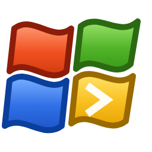
</p>

# Introduction to AgentXP

AgentXP is a program that gives coding agents a virtual Windows XP desktop to work on. You watch the agent open apps, read files, run commands, and change code. You decide what the agent can use.

## Table of Contents

- 1 - About AgentXP
  - What AgentXP Does
  - Words Used in This Guide
- 2 - Installing AgentXP
- 3 - The Desktop Connection Window
  - Creating a Desktop
  - Connecting and Disconnecting
  - Renaming and Deleting a Desktop
  - Notifications
- 4 - The Desktop
  - The Top Bar
  - The Taskbar
  - The Start Menu
  - The Action Center
  - The InfoPanels
- 5 - Getting Started
  - Creating a Desktop for a Project
  - Plugging In a Project
  - Starting a Chat
  - Sending a Message
  - Undoing a Change
- 6 - What the Agent Can Use
  - Permissions Decide the Tools
  - Seeing What the Agent Does
  - When the Agent Shows You Something
  - Windows That the Agent Opens
  - Pause and Take Control
- 7 - Allowing or Denying an Action
  - Answering a Request
  - Choosing When AgentXP Asks
- 8 - Drives and Files
  - The C: Drive
  - USB Drives
  - Safely Remove
- 9 - The Apps
  - The Chat Pane
  - The Event Viewer
  - Task Scheduler
  - Adding an Agent
- 10 - Windows That the Agent Draws
  - Three Places for a Form
  - The Row in the Chat
- 11 - Who Needs a Mouse?
- 12 - For Developers
  - Commands
  - How AgentXP Is Built
  - The Scripted Agent
  - Test Ids
  - Screenshots for This Guide
  - More to Read
- 13 - Need Help?

---

## 1 - About AgentXP

This chapter tells you what AgentXP does and explains the words that this guide uses.

### What AgentXP Does

AgentXP starts a coding agent as a separate program on your computer. The agent does not work in one window. It lives on a desktop, a small virtual Windows XP computer. The desktop is your screen. The agent works out of sight and puts its results in the apps of the desktop.

You see exactly what the agent can use, because the top bar shows the permissions that you set in the Control Center. Each step of the agent shows in the chat, with a link to the file, the change, or the command.

AgentXP stores your desktops, chats, and changes on your computer. Nothing leaves your computer except the requests that the agent itself sends to its own service.

### Words Used in This Guide

- **Agent** – A program that writes and changes code for you, for example Claude Code.
- **Desktop** – A long-lived virtual computer for one or more projects. It keeps its apps, chats, and files when you close its window.
- **Chat** – One conversation with an agent. A Chat window shows it.
- **App** – A program that opens as a window on a desktop, for example Explorer or Terminal.
- **Drive** – A place for files on a desktop. Each desktop has a C: drive and can have USB drives.
- **USB drive** – A project folder that you plug in to a desktop. It gets the letter E: or a later letter.
- **Tool** – An action that an agent can do, for example "run a command". An open app gives the agent its tools.
- **ACP** – The Agent Client Protocol. AgentXP uses it to talk to agents.

## 2 - Installing AgentXP

AgentXP runs on Windows, macOS, and Linux. Before you install it, make sure that your computer has these programs:

- **[Node.js](https://nodejs.org)** version 22 or later
- **[Git](https://git-scm.com)**
- An ACP agent. AgentXP adds Claude Code for you. Claude Code uses your Claude Code sign-in or the `ANTHROPIC_API_KEY` environment variable.

To install and start AgentXP, follow the steps below:

1. Open a command prompt.
2. Type the commands below to download AgentXP and install its parts:

   ```bash
   git clone https://github.com/flying-dice/AgentXP.git agentxp
   cd agentxp
   npm install
   ```

3. Type `npm run dev` and press Enter. The **AgentXP Desktop Connection** window appears.

**Tip:** To make an installer for your computer, type `npm run dist`. The installer appears in the `dist` folder. On macOS, type `npm run app:install` to make the app and install it in your Applications folder in one step. Quit AgentXP first, or type `npm run app:install -- --quit` to let the script quit it. The app that it replaces is kept in `dist/previous-install`.

## 3 - The Desktop Connection Window

The **AgentXP Desktop Connection** window opens when AgentXP starts. It lists your desktops and lets you create, connect, rename, and delete them.

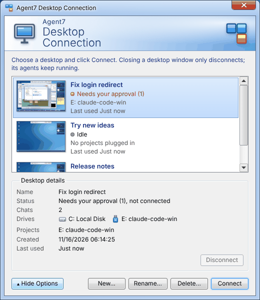

The window has these parts:

- **Desktop list** – Shows one row for each desktop, with a picture, its name, its state, its projects, and its last use. A **Connected** label marks a desktop that has a window.
- **Desktop details** – Shows the name, state, number of chats, drives, and dates of the selected desktop. Click **Show Options** to see it.
- **Disconnect** – Closes the window of the selected desktop. It is in the details.
- **New...** – Opens the **New desktop** dialog box.
- **Rename...** – Changes the name of the selected desktop.
- **Delete...** – Removes the selected desktop.
- **Connect** – Opens the window of the selected desktop.

The state of a desktop is **Idle**, **Running**, **Needs your approval**, or **Error**. The state **Needs your approval** shows the number of requests that wait for you.

### Creating a Desktop

To create a desktop, follow the steps below:

1. Click **New...**. The **New desktop** dialog box appears.
2. Type a name in **Desktop name**.
3. Select each project that you want to plug in as a USB drive. To add a project that the list does not show, click **Browse...**.
4. In **Agent**, select the agent that the desktop uses.
5. Click **Create**. The desktop appears in the list.

### Connecting and Disconnecting

To open a desktop, select it in the list and click **Connect**. You can also double-click the desktop or press Enter. The desktop window appears next to this window.

To disconnect a desktop, follow the steps below:

1. Select the desktop in the list.
2. Click **Show Options**. The desktop details appear.
3. Click **Disconnect**. The desktop window closes.

You can also click the red **Close** button of the connection bar at the top of the desktop window, or click **Start -> Disconnect**. The result is the same. Closing a desktop window only disconnects the desktop. The agents, the chats, and the requests for permission keep running in AgentXP.

To come back, click **Connect** again. The apps, chats, and files are as you left them. To show this window again from a desktop, click **Start -> AgentXP Desktops...**.

### Renaming and Deleting a Desktop

To rename a desktop, select it and click **Rename...**. Type the new name and click **OK**. Each desktop needs its own name.

To delete a desktop, follow the steps below:

1. Select the desktop in the list.
2. Click **Delete...**. A message box asks if you want to delete the desktop.
3. Click **Yes**. The desktop leaves the list.

**Caution:** Do not delete a desktop if you want to keep its chats. AgentXP removes the C: drive, the chats, the notes, and the logs of the desktop. Your project folders stay on your computer.

### Notifications

If an agent asks for permission on a desktop that has no window, AgentXP shows a notification. The text is "AgentXP: Fix login redirect needs your approval", where the name is the name of the desktop. Click the notification to connect the desktop. The row of the desktop in the list shows the state **Needs your approval**.

## 4 - The Desktop

The desktop window looks like Windows XP. It has a top bar for the agent, windows for the apps, a taskbar at the bottom, and infopanels on the right side.

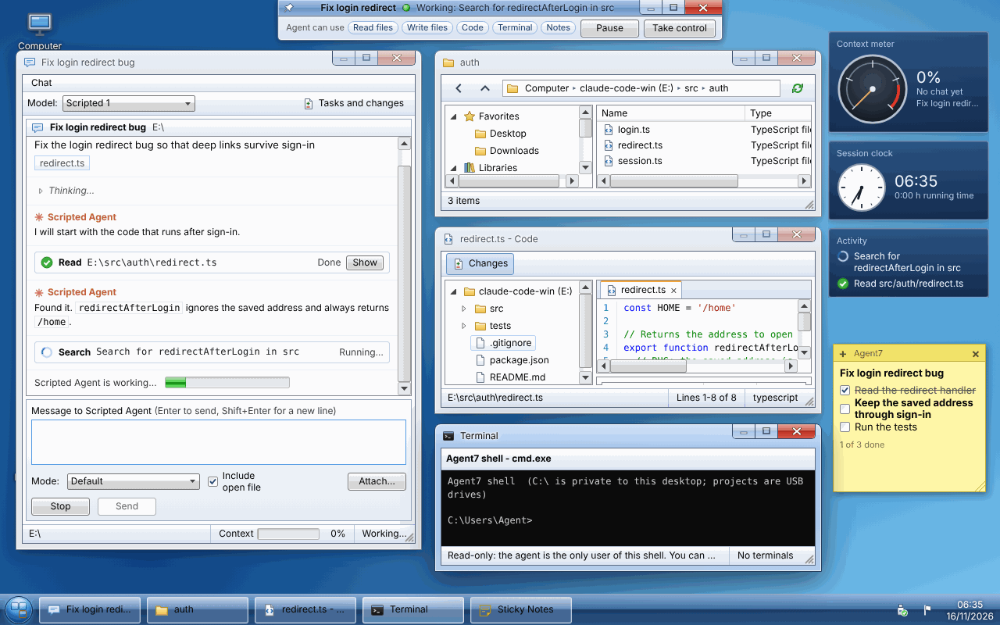

The desktop has these parts:

- **Top bar** – Shows what the agent does now and the tools that it can use.
- **Desktop icons** – Open **Computer**, **Chats**, **Code**, **Terminal**, **Browser**, **Control Center**, and **Recycle Bin**. Double-click an icon.
- **Windows** – Show the apps. You can move, resize, minimize, maximize, and close them. To maximize a window, drag its title bar to the top of the desktop.
- **Sticky notes** – Stay on the desktop. The agent can read and write them while Sticky Notes is open.
- **InfoPanels** – Show the context meter, the clock, and the activity of the agent on the right side.
- **Taskbar** – Shows the **Start** button, one button for each window, and the notification area.

### The Top Bar

The top bar is at the top of the desktop. It starts with the connection bar. The rest of the top bar shows the state of the agent, a button and a check box.

- **Connection bar** – Shows the name of the desktop. The pin keeps the top bar open. If you click the pin again, the top bar folds away until you point to it. The next buttons minimize and maximize the desktop window. The red **Close** button is **Disconnect**. It closes the window, and the agents keep running.

- **Status** – Shows **Idle**, **Paused**, or **Working** with the name of the action that runs now.
- **Pause all agents** – Stops the running turns of every agent on the desktop and blocks new tool calls. The button changes to **Resume**.
- **Ask before every action (this session only)** – While it is selected, every tool call of the agent waits for your approval. It is not saved.
- **Agent can use** – Shows one chip for each group of tools that the agent can use now, for example **Read files**, **Terminal**, or **Notes**.

### The Taskbar

The taskbar is at the bottom of the desktop. Click a window button to show, hide, or bring forward that window.

The notification area is at the right end of the taskbar. It has these parts:

- **Safely Remove Hardware** – Shows a USB stick with a green mark. It appears while a USB drive is plugged in. Click it to remove a drive.
- **Action Center** – Shows a flag. A red number on the flag counts the requests that wait for you.
- **Clock** – Shows the time and the date.

### The Start Menu

Click the **Start** button, or press Ctrl+Esc, to open the Start menu.

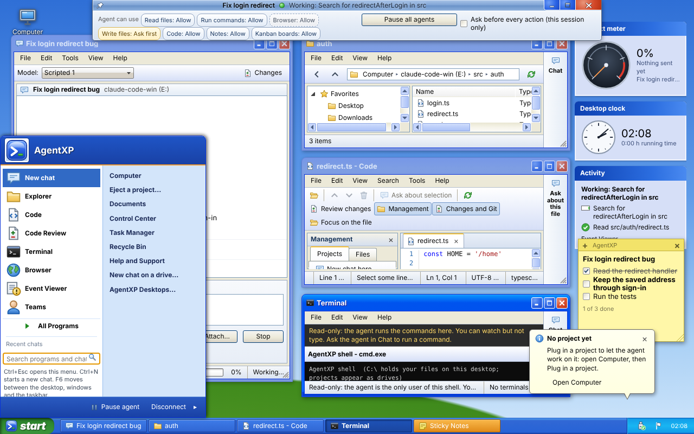

The Start menu has these parts:

- **Programs** – Opens **New chat**, **Explorer**, **Code**, **Terminal**, and **Browser**.
- **Accessories** – Opens **Notepad**, **WordPad**, **Agent Paint**, **Agent Diagrams**, **Snipping Tool**, **Sticky Notes**, and **Kanban**.
- **System Tools** – Opens **Event Viewer**, **Task Manager**, **Task Scheduler**, and **Control Center**.
- **Recent chats** – Opens a chat that you closed.
- **Search apps and chats** – Finds an app or a chat by its name.
- **Places** – Opens **Computer**, **Documents**, **Control Center**, **Task Manager**, **Recycle Bin**, **New chat on a drive...**, and **AgentXP Desktops...**.
- **Pause agent** – Pauses the agent. The button changes to **Resume agent**.
- **Disconnect** – Closes the desktop window. The agents keep running. Click the arrow next to the button for **Disconnect**, **Switch desktop...**, and **Delete desktop...**. **Switch desktop...** shows the **AgentXP Desktop Connection** window. **Delete desktop...** asks you first.

### The Action Center

Click the flag in the notification area to open the Action Center. It lists each request for permission from every chat of the desktop, newest first.

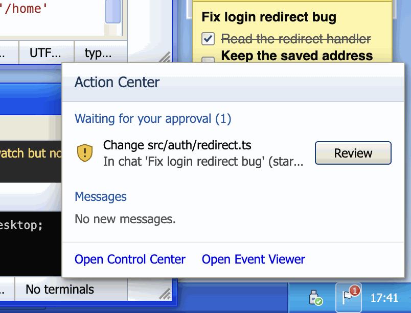

Click **Review** next to a request to answer it. Chapter 7 explains how. The **Messages** list shows notes from AgentXP, for example that a USB drive is safe to remove. Click **Open Control Center** to change the permissions.

### The InfoPanels

The infopanels are on the right side of the desktop. They have these parts:

- **Context meter** – Shows how much of its context the agent uses in the chat.
- **Session clock** – Shows the time and how long the agent runs.
- **Activity** – Lists the last actions of the agent and their state.

To hide the infopanels, open **Control Center**, click **Appearance**, and clear **Show infopanels on the desktop**.

## 5 - Getting Started

This chapter takes you from a new installation to your first chat. You create a desktop, plug in a project, and send a message to the agent.

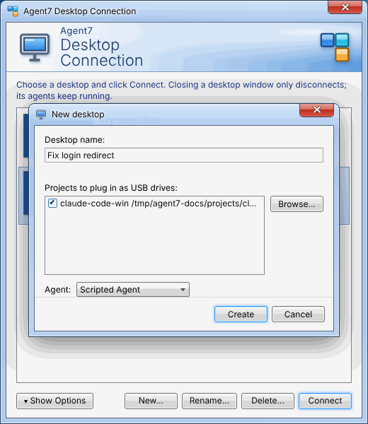

**Note:** The screenshots in this guide show the Scripted Agent. This is a test agent that AgentXP contains. It gives the same answer each time. Your own agent gives other answers.

### Creating a Desktop for a Project

To create a desktop, follow the steps below:

1. In the **AgentXP Desktop Connection** window, click **New...**. The **New desktop** dialog box appears.
2. Type a name, for example `Fix login redirect`.
3. Click **Browse...**, select the folder of your project, and click **Select Folder**. The project appears in the list and is selected.
4. Click **Create**. The desktop appears in the list.
5. Click **Connect**. The desktop window appears.

**Note:** On macOS and Linux, the button in step 3 has the name **Open**.

### Plugging In a Project

If you did not select a project in the **New desktop** dialog box, you can plug it in later. If you did, the project is already a USB drive. Go to the next section.

To plug in a project, follow the steps below:

1. Click **Start -> Computer**. The **Computer** window appears.
2. Click **Plug in a project...** in the toolbar. The folder browser of your computer appears.
3. Select the folder of your project and click **Select Folder**. The **AutoPlay** dialog box appears.
4. Click **Start a chat on this drive**. A Chat window appears.

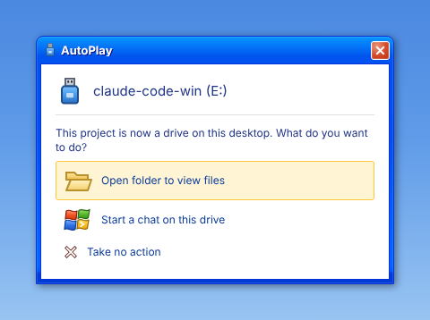

The **AutoPlay** dialog box has three choices. **Open folder to view files** opens Explorer on the drive. **Start a chat on this drive** opens a Chat window that works on the drive. **Take no action** closes the dialog box.

### Starting a Chat

To start a chat, click **Start -> New chat**. A Chat window appears. The chat works in the home folder `C:\Users\Agent` of the desktop. The agent can still use the files on each USB drive.

To start a chat on a USB drive at any time, use one of these ways:

- Click **Start -> New chat on a drive...**, select the drive, and click **Start chat**.
- In **Computer**, right-click a drive or a folder and click **Start a chat here**.
- Use the **AutoPlay** dialog box when you plug in a drive.

The status bar of the Chat window shows the folder of the chat, for example `E:\`.

To remove the messages from a Chat window, click **Chat -> Clear transcript...** and click **Yes**.

**Tip:** The first start of Claude Code can take a minute. AgentXP downloads the agent with `npx` the first time.

### Sending a Message

To send a message to the agent, follow the steps below:

1. Click in the box under **Message to**.
2. Type your task, for example "Fix the login redirect bug so that deep links survive sign-in".
3. Press Enter. To start a new line without sending, press Shift+Enter.

The agent replies in the chat. Each action of the agent appears as a row with its state. To see the output of an action, click **Show** on its row. To stop the agent, click **Stop**.

The Chat window has these parts:

- **Model** – Lets you select the model of the agent. The agent supplies the list.
- **Tasks and changes** – Opens a pane with the **Changes** tab and the **Tasks** tab.
- **Message to** – The box where you type your next message.
- **Mode** – Sets how the agent works. The agent supplies the modes.
- **Include open file** – Sends the file that is open in the Code app with your message.
- **Attach...** – Sends a file from your computer with your message.
- **Status bar** – Shows the folder of the chat, how much context the chat uses, and the connection state.

### Undoing a Change

The **Changes** tab lists each file that the agent created, changed, or deleted in the chat. To undo the change to one file, follow the steps below:

1. In the Chat window, click **Tasks and changes**, and then click the **Changes** tab.
2. Select the file.
3. Click **Revert**. A message box appears.
4. Click **Yes**. AgentXP writes the original file back to the drive.

The reverted change goes to the Recycle Bin. To get it back, open **Recycle Bin**, select the item, and click **Restore this item**.

**Caution:** Do not click **Revert** if you want to keep the change. The file goes back to how it was before the agent edited it.

## 6 - What the Agent Can Use

The permissions in the Control Center decide which tools the agent can use. No app has to be open. You find the setting of the main tools in the **Agent can use** list of the top bar.

### Permissions Decide the Tools

Each tool belongs to a group, for example **Read files** or **Run commands**. The Control Center sets each group to **Allow**, **Ask**, or **Deny**. The agent can use a tool of a group at any time, as far as its setting lets it. The table below shows the groups and their tools.

| Group | The agent can | Tool names |
|---|---|---|
| Read files | Read and list files, find files by name or by a word, and search inside files | `fs_list`, `fs_find`, `code_read`, `code_search`, `fs/read_text_file` |
| Write files | Change and write files. Each change goes to the Changes pane. | `code_edit`, `code_write`, `fs/write_text_file` |
| Agent may show you things | Show you one thing with a note that tells why: lines of a file, a change, a review comment, a card, a diagram shape, a page element, or a window. The control has the choices Always, Ask, and Never. | `show` |
| Notepad | Open a file in Notepad for you, and read it | `notepad_open`, `notepad_read` |
| Run commands | Run commands and read their output | `terminal_run`, `terminal_read`, `terminal/*` |
| Browser | Open web pages, read the whole page, find items, click, type (also in chat boxes), press keys, scroll, wait, use tabs, go back, and take a picture. The agent can use web apps such as a team chat after you sign in. Needs an open Browser window. | `browser_navigate`, `browser_read`, `browser_find`, `browser_click`, `browser_type`, `browser_press`, `browser_scroll`, `browser_wait`, `browser_select`, `browser_tabs`, `browser_back`, `browser_forward`, `browser_reload`, `browser_screenshot` |
| Agent Paint | Draw, read the picture, clear it, and resize it. Needs an open Agent Paint window. | `paint_draw`, `paint_read`, `paint_clear`, `paint_resize` |
| Agent Diagrams | Draw flowcharts, UML, ER diagrams, org charts, network maps, and swimlanes with glued connectors. Lay them out, read them, look at them as a picture, and save them. Needs an open Agent Diagrams window. | `diagram_new`, `diagram_stencils`, `diagram_add`, `diagram_update`, `diagram_delete`, `diagram_layout`, `diagram_arrange`, `diagram_pages`, `diagram_select`, `diagram_read`, `diagram_export`, `diagram_save`, `diagram_open` |
| WordPad | Open, read, and write documents | `wordpad_open`, `wordpad_read`, `wordpad_write` |
| Sticky Notes | List, add, change, and remove notes, and keep a plan note | `notes_list`, `notes_add`, `notes_update`, `notes_remove` |
| Kanban boards | List, read, create, and change boards, lists, and cards, and move cards | `board_list`, `board_get`, `board_create`, `board_rename`, `board_delete`, `board_add_column`, `board_rename_column`, `board_delete_column`, `board_add_card`, `board_update_card`, `board_move_card`, `board_delete_card` |
| Event Viewer | Search the messages of the desktop | `events_query` |
| Screen capture | Take a picture of the desktop or of one window | `screen_capture` |
| Recycle Bin | List and restore reverted changes | `recycle_list`, `recycle_restore` |
| Code review | Review the changes of a project in its own review session: list the changes, read a diff, leave comments, and give a verdict. Needs an open Code Review window. | `review_open` (any time), `review_list_changes`, `review_read_diff`, `review_add_comment`, `review_submit` |

The agent always can see the desktop, list the drives, open and close apps, and draw windows in the chat. Chapter 10 explains these windows.

Only the tools of the Browser, Agent Paint, Agent Diagrams, and Code Review need an open window, because they work on what that window shows. If the agent calls one of these tools while its window is closed, AgentXP refuses the call and tells the agent which app to open.

To take a tool away from the agent, set its group to **Deny** in the Control Center. Chapter 7 explains how to set it.

**Note:** AgentXP controls the tools that the agent asks AgentXP to run. An agent can have its own built-in tools, and AgentXP cannot stop those. Claude Code uses AgentXP for files and commands when AgentXP offers them.

### Seeing What the Agent Does

The agent works out of your sight. When it reads, searches, changes a file, or runs a command, no window opens and nothing takes the focus. You can still see each step in two clicks:

- **Chat** – Shows each step as a row. A row has a link to where you can see the step: **Show in Code**, **Show diff**, **Show in Terminal**, or **Show in Browser**.
- **Activity** – Lists the latest steps in the infopanel at the right. Click a line to go to the same place, or to the chat that did the step.
- **Top bar** – Shows **Working:** and the current step. Click the text to go to the chat that does the work. While two or more chats work, it reads, for example, **3 agents working**. Click it to see each agent with its color, its name, and its step, with **Open chat** and **Follow**.
- **Team Chat** – Each member row says the step of the member in plain words, for example **reading auth.ts**.

A window that already shows the file or the command updates in place. If Code shows the file that the agent changes, Code reloads it and marks the changed lines. An open Terminal shows each command of the agent as it runs.

### When the Agent Shows You Something

An agent can point you at one thing on purpose, with the `show` tool. It always gives a reason. If you work in the chat of that agent, the window comes to the front at the exact spot, for example the lines in Code. The agent cursor, an arrow with the name of the agent, moves there, and a note tells why. Your keyboard stays in the chat. Click **OK** to close the note, or **Reply** to answer in the chat.

Only the chat that you work in can move your view. Any other chat, a team member, or a scheduled task asks first: a balloon **Show request** appears with **Show** and **Not now**, and the Action Center keeps it. AgentXP shows one thing at a time. Any click or key closes the note. **Pause all agents** hides the agent cursors and removes the shows that wait.

### Following an Agent

To watch one agent while it works, follow it: click **View -> Follow this chat** in its Chat window, **Follow** on its row in a Team Chat room, or **Follow** in the list of the agents that work on the top bar. While you follow it, Code comes to the front at the lines that it reads or changes, the Terminal shows its commands, and its agent cursor moves with each step. There is no note, and the keyboard stays where you are. While you type, the steps wait.

The top bar then reads **Following** and the name of the agent. Click **Stop following** to stop. The follow also stops when you pause the agents, when the chat closes, or at the end of the turn. To follow the next turns too, select **Keep following** on the top bar.

### Windows That the Agent Opens

Some apps hold the output of the agent: the Browser, Agent Paint, Agent Diagrams, WordPad, Code Review, and the windows that the agent draws. The agent can open these apps. A window that the agent opens appears behind the window that you use. It does not take the focus, and its taskbar button flashes until you click it.

The control **Agent may open apps** in the Control Center decides if the agent can open windows itself. It applies to every window that the agent opens. Chapter 7 explains how to set it.

### Pause and Take Control

To stop the agent at once, click **Pause all agents** in the top bar. The agent stops its turn, and AgentXP refuses new tool calls. To let the agent continue, click **Resume**.

To approve each action yourself, select **Ask before every action (this session only)** in the top bar. Each tool call then asks you first. To go back, clear the check box.

## 7 - Allowing or Denying an Action

Some actions need your permission, for example a file edit or a command. When the agent asks, AgentXP dims the desktop and shows the **User Account Control** style dialog box at once, whichever window or chat asked.

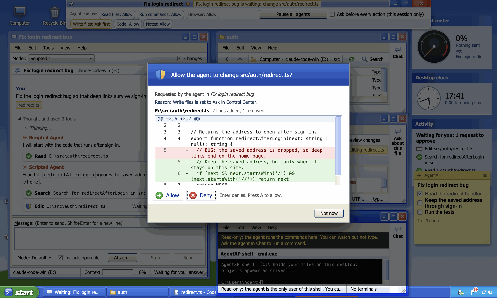

The dialog box has these parts:

- **Question** – Tells you what the agent wants to do, for example "Allow the agent to change src/auth/redirect.ts?"
- **Requested by** – Names the chat, or the team member and room, that asked.
- **Reason** – Tells you why AgentXP asks, for example "Write files is set to Ask in Control Center."
- **Change** – Shows the file, how many lines are added and removed, and the changed lines; or the command. A long change scrolls.
- **Allow** and **Deny** – Answer the request. The agent supplies the names of these buttons.
- **Not now** – Closes the dialog box. The request stays in the Action Center.

### Answering a Request

To answer a request for permission, follow the steps below:

1. Read the change or the command in the dialog box.
2. If you agree, click **Allow** or press A. The agent continues.
3. If you do not agree, click **Deny** or press Enter. The agent does not do the action.

For a moment after the dialog box appears it takes no answer, so a key that you were typing in another window does not answer it.

**Tip:** Press Esc or click **Not now** to answer later. The request stays in the Action Center: click the flag in the notification area, then **Review**, to open the dialog box again.

### Choosing When AgentXP Asks

The Control Center sets what the agent can do without asking. To change it, follow the steps below:

1. Click **Start -> Control Center**. The **Control Center** window appears.
2. Click **Permissions**.
3. In the **Setting** column, select **Allow**, **Ask**, or **Deny** for a permission.
4. Click **Apply**.

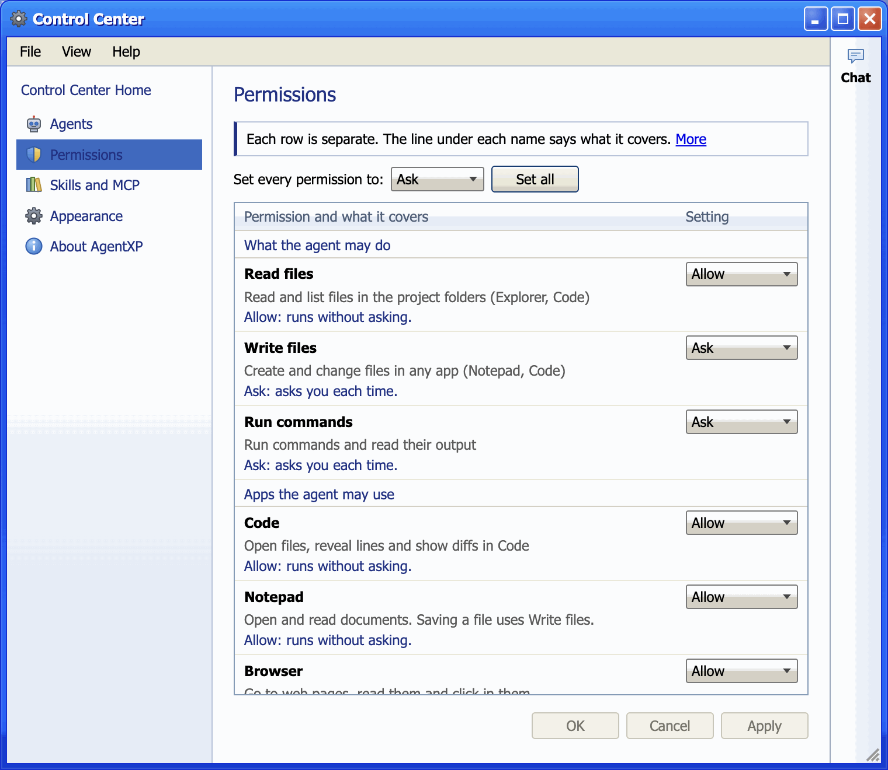

The **Setting** column has three choices:

- **Allow** – The agent does the action at once.
- **Ask** – The agent waits until you answer a request in the Action Center.
- **Deny** – AgentXP refuses the action.

The page lists **Read files**, **Write files**, **Notepad**, **Code**, **Terminal**, **Browser**, **Paint**, **WordPad**, **Notes**, **Events**, **Screen capture**, **Recycle Bin**, and **Agent may open apps**. A new desktop asks before the agent writes files, runs commands, writes in WordPad, or restores an item from the Recycle Bin. It allows the rest.

## 8 - Drives and Files

Each desktop has a C: drive of its own. It can also have USB drives, which are your projects. The agent works only on these drives.

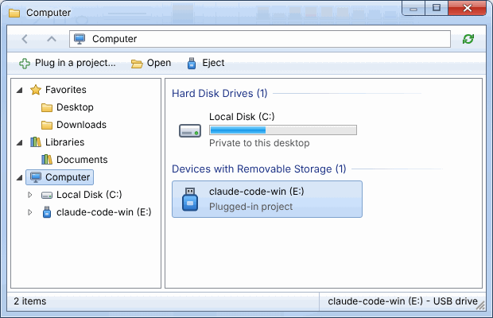

The **Computer** window is the Explorer app. To open it, click **Start -> Computer** or double-click **Computer** on the desktop. It has these parts:

- **Navigation pane** – Shows your favorite folders, the libraries, and the drives.
- **Toolbar** – Has **Plug in a project...**, **Open**, and **Eject**.
- **Hard Disk Drives** – Shows the C: drive and how full it is.
- **Devices with Removable Storage** – Shows each USB drive.
- **Agent status** – Shows, in the file list of a folder, what the agent did to each file, for example that it read or changed it.

### The C: Drive

The C: drive is the own disk of the desktop. It is private to the desktop. The home folder of the agent is `C:\Users\Agent`. It has the folders `Desktop`, `Documents`, and `Downloads`. The `Temp` folder is next to it.

AgentXP stores the C: drive in its own data folder. It deletes the C: drive when you delete the desktop. You cannot remove the C: drive from the desktop.

### USB Drives

A USB drive is a project folder that you plug in. It gets the first free letter from E: to Z:. If you plug in the same project again, it gets its letter again. AgentXP shows the drive with the name of the folder, for example `claude-code-win (E:)`.

A path on a USB drive looks like `E:\src\auth\redirect.ts`. The agent and the apps use these paths. The agent can read and change the real files in the folder.

The **AutoPlay** dialog box appears when you plug in a project on a connected desktop. Chapter 5 describes its choices.

### Safely Remove

To remove a USB drive, follow the steps below:

1. Click the **Safely Remove Hardware** icon in the notification area. A menu appears.
2. Click **Eject** and the name of the drive, for example **Eject claude-code-win (E:)**.
3. If a chat works on the drive, a message box asks if you want to remove it anyway. Click **Yes**. A balloon tells you that the drive is safe to remove.

You can also select the drive in the **Computer** window and click **Eject**. The agent loses the drive at once. Each request for a file or a command on the drive fails, and the Event Viewer shows a warning. The files in your project folder stay as they are.

To get the drive back, plug in the project again. The changes of the agent to its files are still in the **Changes** tab.

## 9 - The Apps

An app is a program that opens as a window on the desktop. Click **Start** to open an app. Some apps give tools to the agent. Chapter 6 lists them.

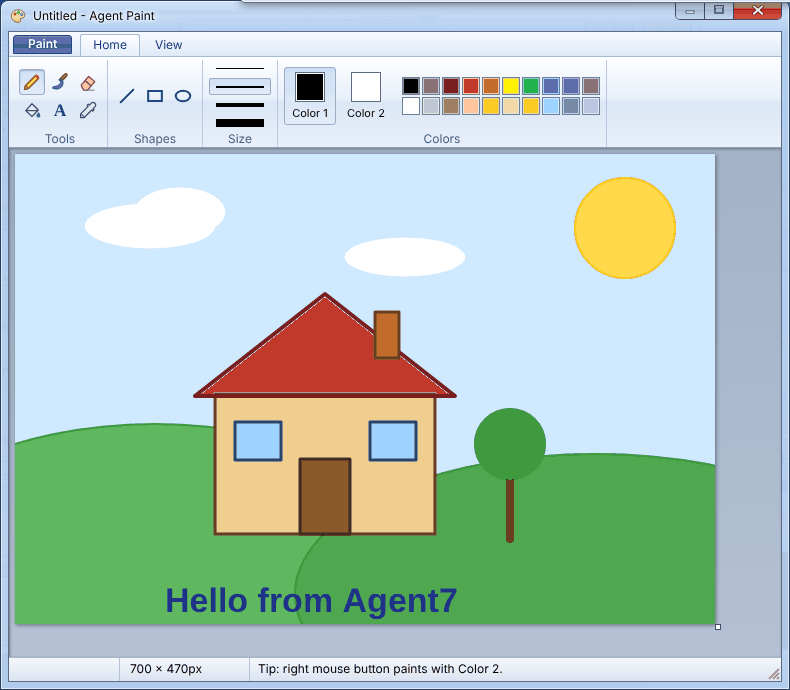

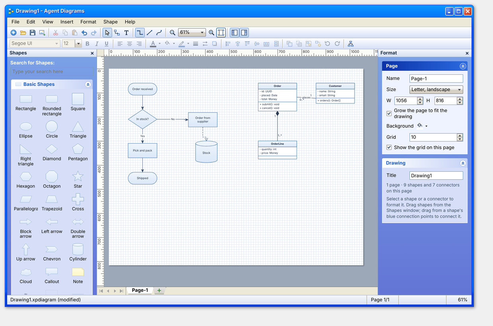

The desktop has these apps:

- **Chat** – Shows one chat with an agent. You write your messages here and follow the work of the agent.
- **Chat pane** – A short chat at the right edge of every other app window. It knows what the window shows. See the section below.
- **Explorer** – Shows the files on the drives. It shows what the agent did to each file.
- **Code** – Shows code with colors, lists the changes of the agent, and lets you revert them.
- **Git in Code** – Shows the git status of a project in the file tree: **M** is a changed file, **A** is an added file, **D** is a deleted file, **U** is a new file, and **!** is a conflict. A folder with a changed file below it has a dot. The status bar shows the branch name and how many commits you are ahead (↑) or behind (↓). A colored bar next to a line number shows a line that is new (green) or changed (blue). A red triangle shows deleted lines. To see the old lines, click the bar. Then click **Revert hunk** to bring the old lines back. To go to the next change, press **Alt+F5**.
- **Terminal** – Shows the commands that the agent runs. You can watch it, and you cannot type in it.
- **Notepad** – Lets you read and edit plain text files.
- **WordPad** – Lets you read and write documents in Markdown.
- **Browser** – Shows web pages. You and the agent can use it.
- **Agent Paint** – Lets you draw. The agent can draw in it too.
- **Agent Diagrams** – Lets you draw diagrams from stencils: flowcharts, UML, ER diagrams, org charts, network maps, and swimlanes. Connectors stay glued to their shapes. The agent can draw in it too.
- **Sticky Notes** – Puts notes on the desktop. You and the agent can read them. A plan note shows the tasks of a chat.
- **Kanban** – Shows boards of cards with a title, a description, and an assignee. Drag cards between lists. You and the agents can read and write the boards, so a team of agents can track its work on one board.

  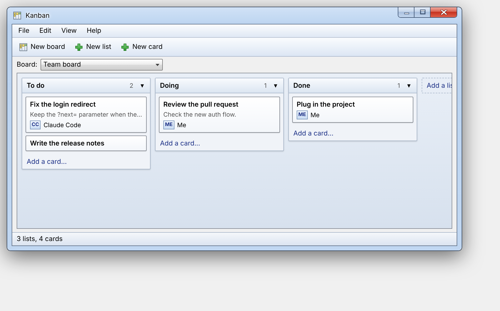

- **Snipping Tool** – Takes a picture of an area of the desktop or of one window.
- **Event Viewer** – Lists the ACP, AG-UI, and MCP messages of the desktop as they happen. Task Scheduler writes its own log there.
- **Task Scheduler** – Asks an agent to do a job at a time that you choose: once, every day, every week, every month, or when AgentXP starts. Each task keeps a history of its runs. See `manuals/task-scheduler.md`.
- **Recycle Bin** – Keeps the changes that you reverted, so that you can restore them.
- **Task Manager** – Lists the chats, the agent processes, the terminals, and the context use. **End process** stops an agent process.
- **Control Center** – Sets the agents, the permissions, and the appearance of the desktop.
- **Help and Support** – Shows the manual of each app. Press F1 to open the manual of the window that has focus. The manuals are in `manuals`.

### The Chat Pane

Every app window has a chat pane at its right edge. Use it to ask a short question about what you look at, for example "Explain this". The pane starts closed, as a thin strip. To open it, click the strip, click **View -> Chat pane**, or press Ctrl+Shift+C.

The agent sees the open file, the selection, or the page, depending on the app. It answers in a few sentences. The pane chat belongs to its window. When you close the window, AgentXP deletes the pane chat. Click **New conversation** to start again. The pane chat is not in your list of chats.

The right-click items **Explain this**, **Send selection to chat**, and **Ask chat...** use the chat pane of the window. **Open in Chat window** starts a full chat instead. Chat and Code Review have no chat pane. The manual **Using the Chat Pane** has the details.

### The Event Viewer

The Event Viewer shows each message between AgentXP and the agent. Select a message to read its details. Use it to find out why the agent did something, or why AgentXP refused it.

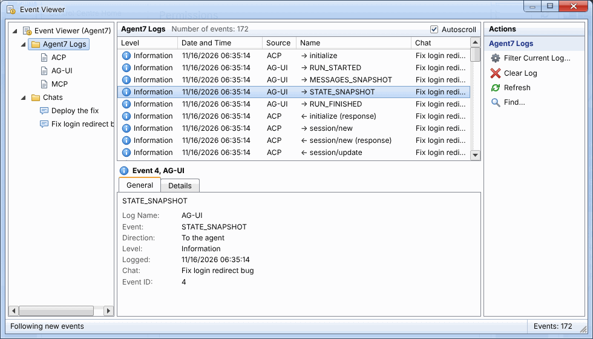

### Task Scheduler

Task Scheduler runs an agent on a schedule. Open it from **Start -> System Tools -> Task Scheduler**, or double-click its icon on the desktop. To make a task, click **Create Basic Task** in the task pane. The wizard asks for a name, a trigger, a project, and a prompt. Use **Create Task** when you need more than one trigger, or the conditions and settings.

The action can also choose the skills and the MCP servers of the run: everything that is switched on, a profile, a team, or the skills, servers, and tools that you check. A task runs only while AgentXP is open. When AgentXP was closed at the start time, the task runs at the next start if you select **Run task as soon as possible after a missed start**. Select a task, and then open its **History** tab to see each run and its result. The manual `manuals/task-scheduler.md` describes each control.


### Adding an Agent

AgentXP adds Claude Code and the Scripted Agent for you. You can add other agents that speak ACP. To add an agent, follow the steps below:

1. Click **Start -> Control Center**. The **Control Center** window appears.
2. Click **Agents**, and then click **Add...**. The **Add Agent** dialog box appears.
3. Type the name of the agent in **Name** and the command that starts it in **Command**.
4. Type each argument on its own line in **Arguments**.
5. If the agent needs environment variables, type each one as `KEY=VALUE` on its own line in **Environment**.
6. Click **OK**.

To use an agent for new desktops, select it and click **Set as Default**.

**Note:** The command must start the agent in ACP mode. For example, the Gemini CLI uses the `--experimental-acp` argument.

## 10 - Windows That the Agent Draws

The agent can draw its own forms, for example a form, a table of test results, or a code review. AgentXP gives the agent Windows XP controls for this. The agent uses A2UI, a format for user interfaces that agents send. The agent picks where each form appears: in the chat, in a side pane of the chat, or in its own window on the desktop.

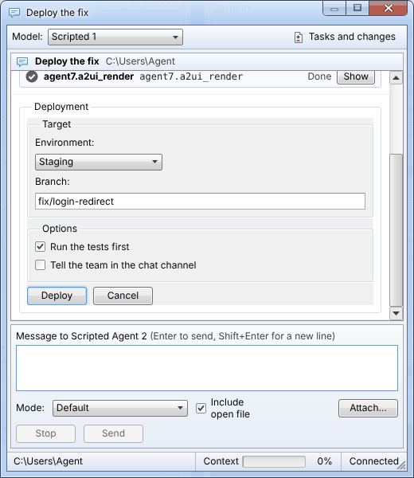

You use these forms like any other form. Select an item, type text, or click a button. When you click a button, AgentXP sends your answer to the chat that the form belongs to. The agent then continues its work. If the agent is still working on a turn, AgentXP ignores the click. Click the button again when the agent is done.

The agent can draw a form at any time. It does not need an open app for this.

A form is new content from the agent. To point you at something that already exists, for example lines of a file or a card, the agent shows it to you instead. Chapter 6 explains shows.

### Three Places for a Form

- **In the chat** – Shows a short form inside the conversation, between the messages. The agent uses this for a quick question or a small answer.
- **In the side pane** – Shows a form in a pane on the right side of the Chat window. The pane stays when the conversation goes on. The agent uses this for a list of steps or a status that you look at while you chat. Several forms become tabs of the pane.
- **In its own window** – Shows a form as a window on the desktop, with its own title bar and a taskbar button. The agent uses this for a larger tool that you keep open, for example a dashboard or an editor. The window opens beside the Chat window. It does not take the keyboard from the chat in which you type, and its taskbar button flashes until you click it.

### The Row in the Chat

Each form that is in the side pane or in its own window has a row in the Chat window. A form in the chat has a small toolbar with only **Delete** and **Move to**.

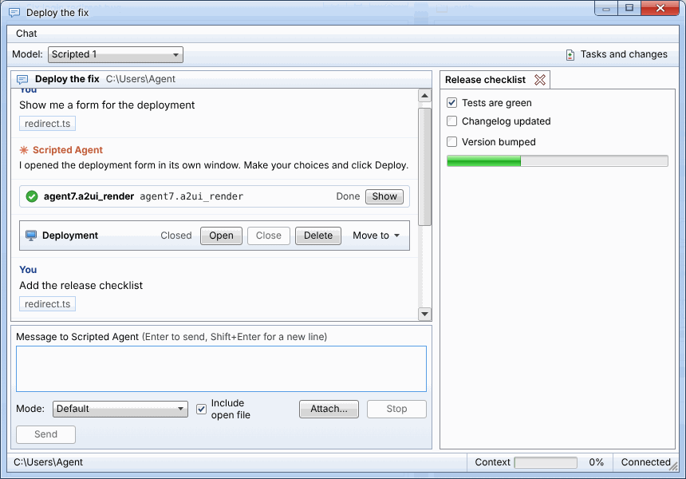

- **Title and state** – Shows the title of the form and **Open** or **Closed**.
- **Open** – Shows the form again. For a window, **Open** also brings the window to the front.
- **Close** – Hides the form. For a window, **Close** does the same as the close button of the window.
- **Delete** – Removes the form for good, after you click **Yes**. The agent must draw it again to get it back.
- **Move to** – Moves the form to **Inline**, **Sidebar**, or **Window**.

To close and open a form, follow the steps below:

1. Click the close button in the title bar of the window, or click the **X** on the tab in the side pane. The form disappears.
2. Find the row of the form in the Chat window. The state is **Closed**.
3. Click **Open**. The form appears again and shows the same data.

**Note:** A closed form still exists. If the agent changes it, AgentXP keeps the change and does not open the form again. The agent learns that you closed it. If the agent draws a new form, a new window opens.

**Tip:** Click **Move to** and select **Window** to turn a form from the chat into a window. Click **Move to** and select **Inline** to put it back.

AgentXP saves your forms. After you restart AgentXP or connect to the desktop again, the windows are there, and the rows show the right state.

## 11 - Who Needs a Mouse?

You can do many tasks in AgentXP with the keyboard. The table below lists the shortcut keys that AgentXP has.

| Press | To |
|---|---|
| Ctrl+Esc | Open or close the Start menu |
| Alt+F4 | Close the window that has the focus |
| Arrow keys | Move between the icons on the desktop |
| Enter | Send the message in a Chat window |
| Shift+Enter | Start a new line in a message |
| Esc | Close a dialog box or a menu, or the review of a request |
| Alt | Show the access keys of the menus |
| Ctrl+N | Start a new file in Notepad and in WordPad, or a new picture in Agent Paint |
| Ctrl+O | Open a file in Notepad and in WordPad |
| Ctrl+S | Save the file in Notepad and in WordPad |
| F5 | Insert the time and the date in Notepad |
| Ctrl+B | Make the selected text bold in WordPad |
| Ctrl+I | Make the selected text italic in WordPad |
| Ctrl+Z | Undo the last stroke in Agent Paint |
| Ctrl+Shift+C | Show or hide the chat pane of the window that has the focus |

The keys for Notepad, WordPad, and Agent Paint work when the window of that app has the focus.

In the **AgentXP Desktop Connection** window, press the Up or Down arrow to select a desktop. Press Enter to connect it. Press F2 to rename it. Press Delete to delete it.

**Tip:** Press Alt and then the underlined letter of a menu to open that menu.

## 12 - For Developers

This chapter is for people who change AgentXP itself. AgentXP uses Electron, Svelte 5, and SQLite. The user interface is a set of Windows XP controls that AgentXP makes itself. AgentXP uses no other user interface library.

### Commands

The commands below run from the AgentXP folder:

| Command | Result |
|---|---|
| `npm run dev` | Starts AgentXP with live reload |
| `npm run build` | Builds the program into the `out` folder |
| `npm start` | Starts the built program |
| `npm test` | Runs the unit tests |
| `npm run test:e2e` | Builds AgentXP and runs the end-to-end tests with Playwright |
| `npm run typecheck` | Finds type errors |
| `npm run storybook` | Opens the control kit in Storybook at port 6006 |
| `npm run agent:scripted` | Runs the Scripted Agent from the terminal |
| `npm run docs:screenshots` | Takes the screenshots of this guide from the built program |
| `npm run dist` | Makes an installer in the `dist` folder |
| `npm run app:install` | macOS: makes the app and installs it in `~/Applications` (`-- --quit` quits a running AgentXP first, `-- --dir <folder>` installs elsewhere) |

To run one end-to-end test, type `npm run test:e2e -- e2e/chat.e2e.ts`. To skip the build, set `A7_E2E_SKIP_BUILD=1`.

### How AgentXP Is Built

AgentXP has three parts that talk to each other:

- **Main process** – Starts agents with ACP, stores data in SQLite, and serves the files and terminals of each agent. It owns the desktops, the drives, and the permissions.
- **AG-UI stream** – Sends each turn to the window as AG-UI events over Electron IPC. AG-UI is a protocol for agent user interfaces.
- **Window** – Shows the desktop with the Windows XP controls, and draws A2UI forms (in the chat, in the side pane, or in a `surface` window) with the official A2UI engine. The agent chooses with the `target` argument of `a2ui_render`: `inline`, `sidebar`, or `window`.

The chat pane of an app window is a session with the role `aside`. The window owns it: AgentXP creates it with the first message and deletes it when the window closes. Chapter 9 describes it for users and `docs/DESKTOP_DESIGN.md` section 12 describes how it works.

The main process gives the agent an MCP server named `agentxp`. The server lists only the tools of the open apps and tells the agent when the list changes. AgentXP serves the file and terminal requests of ACP in the same way. It allows only the paths on `C:` and on the USB drives.

### The Scripted Agent

The Scripted Agent is a fake ACP agent for end-to-end tests. A JSON script says which prompt gives which messages, tool calls, and permission requests. AgentXP adds it to the list of agents at each start. You can step through a script with a control socket.

This script answers a prompt that contains "fix". It asks for permission and then writes a file:

```json
{
  "name": "example",
  "agent": { "name": "scripted-agent", "version": "1.0.0" },
  "rules": [
    {
      "id": "fix",
      "match": { "contains": "fix", "ignoreCase": true },
      "steps": [
        { "type": "message", "text": "I will change one file.\n" },
        { "type": "toolCall", "id": "edit-1", "title": "Write NOTES.md", "kind": "edit", "status": "pending" },
        {
          "type": "requestPermission",
          "toolCallId": "edit-1",
          "options": [
            { "optionId": "allow", "name": "Allow", "kind": "allow_once" },
            { "optionId": "deny", "name": "Deny", "kind": "reject_once" }
          ],
          "branches": {
            "allow": [
              { "type": "writeFile", "path": "{{cwd}}/NOTES.md", "content": "Done.\n" },
              { "type": "toolCallUpdate", "id": "edit-1", "status": "completed" }
            ],
            "deny": [{ "type": "toolCallUpdate", "id": "edit-1", "status": "failed" }]
          }
        },
        { "type": "message", "text": "Finished." }
      ]
    }
  ]
}
```

To use a script, edit the **Scripted Agent** in the Control Center and change its argument to `--script <name or path>`. The folder `agents/scripted-agent/scripts` has samples. The file `agents/scripted-agent/README.md` describes all step types.

### Test Ids

The end-to-end tests find each element only by its `data-testid` attribute. They never use CSS selectors, XPath, or text. The script `scripts/check-e2e-selectors.mjs` fails the build when a test breaks this rule.

Write a test id in lowercase with hyphens, as `<area>-<thing>[-<qualifier>]`. The area is the app or the part of the desktop, for example `taskbar-start`, `uac-allow`, `explorer-drive-e`, or `chat-send`. Give each new control a test id in the same change. Do not rename an existing test id without a reason, because tests depend on it.

### Screenshots for This Guide

The screenshots in `docs/images` come from the real, built program. To take them again, type `npx electron-vite build` and then `npm run docs:screenshots`. The script `scripts/docs-screenshots.mjs` starts AgentXP with a private data folder. It runs the Scripted Agent with the script `scripts/docs-screenshots/chat.json` on a sample project named `claude-code-win`. On Linux without a display, it starts `xvfb-run` for you.

### More to Read

Read these documents before you change AgentXP:

- **[Architecture](docs/ARCHITECTURE.md)** – The layers and how a turn flows through them.
- **[Desktop Design](docs/DESKTOP_DESIGN.md)** – The desktop, the apps, the tools, the drives, and the launcher.
- **[Conventions](docs/CONVENTIONS.md)** – The rules for code, for the control kit, and for tests.
- **[Scripted Agent](agents/scripted-agent/README.md)** – The test agent and its script format.
- **[Documentation Style Guide](docs/DOCUMENTATION_STYLE.md)** – The rules for this guide and for all other user documentation.

## 13 - Need Help?

To open the Start menu and find an app, press Ctrl+Esc. To learn what the agent did, open the Event Viewer from **Start -> System Tools**.

If AgentXP does not work as this guide says, open an issue at **[github.com/flying-dice/AgentXP/issues](https://github.com/flying-dice/AgentXP/issues)**. Tell us what you did, what you expected, and what happened.

To learn more about the protocols that AgentXP uses, go to these sites:

- **[agentclientprotocol.com](https://agentclientprotocol.com)** – The Agent Client Protocol.
- **[docs.ag-ui.com](https://docs.ag-ui.com)** – The AG-UI protocol.
- **[a2ui.org](https://a2ui.org)** – The A2UI format.
