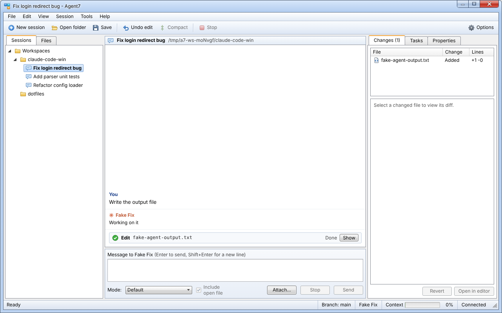
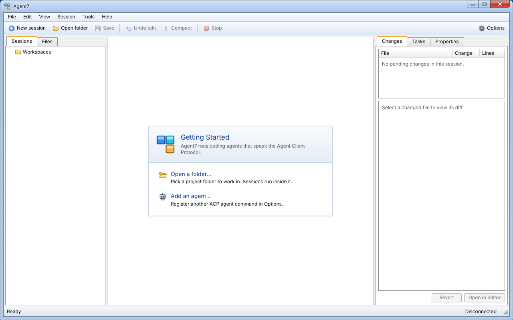
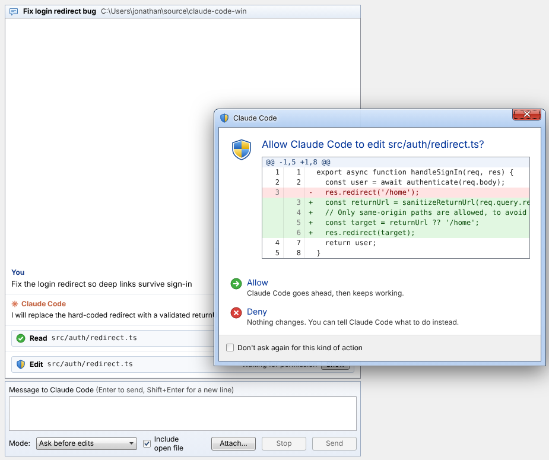
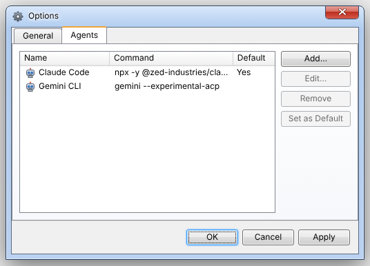
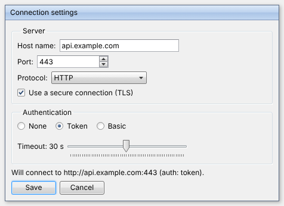
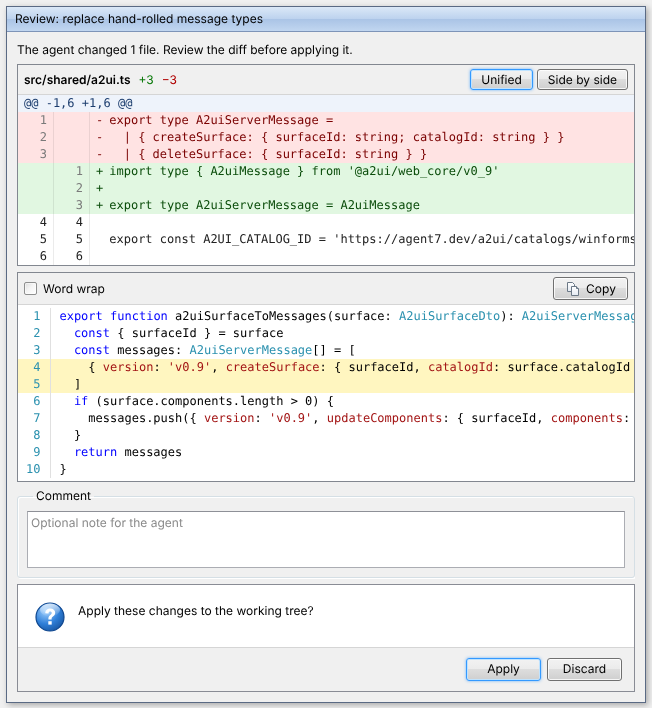
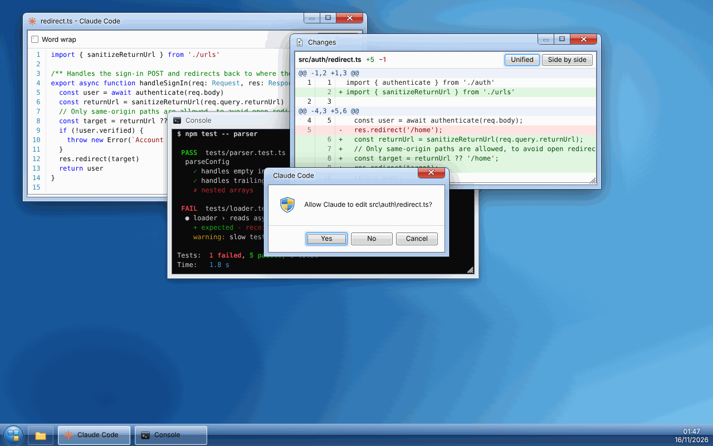

<p align="center">
  
</p>

# Introduction to Agent7

Agent7 is a desktop program that runs coding agents on your computer. It looks and works like a Windows 7 program. You give the agent a task in a folder, and you watch it read files, run commands, and change code.



## Table of Contents

1 - About Agent7
&nbsp;&nbsp;&nbsp;&nbsp;What Agent7 Does
&nbsp;&nbsp;&nbsp;&nbsp;Words Used in This Guide
2 - Installing Agent7
3 - The Main Window
4 - Getting Started
&nbsp;&nbsp;&nbsp;&nbsp;Opening a Folder
&nbsp;&nbsp;&nbsp;&nbsp;Starting a Session
&nbsp;&nbsp;&nbsp;&nbsp;Sending a Message
5 - Allowing or Denying an Action
6 - Reviewing Changes
7 - Agents and Options
8 - Windows That the Agent Draws
9 - Who Needs a Mouse?
10 - For Developers
11 - Need Help?

---

## 1 - About Agent7

This chapter tells you what Agent7 does and explains the words that this guide uses.

### What Agent7 Does

Agent7 starts a coding agent as a separate program on your computer. The agent works only inside the folder that you open. Agent7 shows each message, each command, and each file change in one window.

Agent7 stores your folders, sessions, and changes on your computer. Nothing leaves your computer except the requests that the agent itself sends to its own service.

### Words Used in This Guide

- **Agent** – A program that writes and changes code for you, for example Claude Code.
- **Session** – One conversation with an agent about one task.
- **Folder** – A project folder on your computer. Each session runs inside one folder.
- **Turn** – One message from you and all the work that the agent does in reply.
- **ACP** – The Agent Client Protocol. Agent7 uses it to talk to agents.

## 2 - Installing Agent7

Agent7 runs on Windows, macOS, and Linux. Before you install it, make sure that your computer has these programs:

- **[Node.js](https://nodejs.org)** version 22 or later
- **[Git](https://git-scm.com)**
- An ACP agent. Agent7 adds Claude Code for you. Claude Code uses your Claude Code sign-in or the `ANTHROPIC_API_KEY` environment variable.

To install and start Agent7, follow the steps below:

1. Open a command prompt.
2. Type the commands below to download Agent7 and install its parts:

   ```bash
   git clone https://github.com/flying-dice/AgentXP.git agent7
   cd agent7
   npm install
   ```

3. Type `npm run dev` and press Enter. The Agent7 main window appears.

**Tip:** To make an installer for your computer, type `npm run dist`. The installer appears in the `dist` folder.

## 3 - The Main Window

The main window has three panes. The left pane shows your folders and files. The middle pane shows the conversation. The right pane shows what the agent changed and what it plans to do.

- **Title bar** – Shows the name of the current session.
- **Menu bar** – Gives you all commands, in the **File**, **Edit**, **View**, **Session**, **Tools**, and **Help** menus.
- **Toolbar** – Gives you the most frequent commands, for example **New session** and **Stop**.
- **Sessions** – Lists each folder and the sessions inside it.
- **Files** – Shows the files in the folder of the current session. An **M** marks a file that the agent changed.
- **Transcript** – Shows your messages, the replies of the agent, and each action that the agent takes.
- **Message to the agent** – The box where you type your next message.
- **Changes** – Lists each file that the agent changed in this session, with its difference.
- **Tasks** – Shows the plan of the agent and which steps are done.
- **Properties** – Shows the details of the session. You can change the title, the mode, and the model here.
- **Status bar** – Shows the Git branch, the agent, how much of the context the session uses, and the connection state.

## 4 - Getting Started

When you start Agent7 for the first time, the **Getting Started** panel appears. It gives you two links: **Open a folder** and **Add an agent**.



### Opening a Folder

To open a folder, follow the steps below:

1. Click **File -> Open Folder**. The folder browser of your computer appears.
2. Select the folder that contains your project.
3. Click **Select Folder**. The folder appears under **Workspaces** in the **Sessions** tab.

**Note:** On macOS and Linux, the button in step 3 has the name **Open**.

### Starting a Session

To start a session, follow the steps below:

1. In the **Sessions** tab, select the folder.
2. Click **New session** on the toolbar. Agent7 starts the default agent.
3. Wait until the status bar shows **Connected**.

**Note:** The first start of Claude Code can take a minute. Agent7 downloads the agent with `npx` the first time.

### Sending a Message

To send a message to the agent, follow the steps below:

1. Click in the box under **Message to**.
2. Type your task, for example "Fix the login redirect so deep links survive sign-in".
3. Press Enter. To start a new line without sending, press Shift+Enter.

The agent replies in the transcript. Each action of the agent appears as a row with its status. To see the output of an action, click **Show** on its row.

To stop the agent, click **Stop** on the toolbar or press Esc.

**Tip:** To give the agent a file, click **Attach** and select the file. To send the file that you have open in the **Files** tab, select **Include open file**.

## 5 - Allowing or Denying an Action

Some actions need your permission, for example a file edit or a command. When the agent asks, Agent7 shows a dialog box with the change or the command.



To answer a request for permission, follow the steps below:

1. Read the change or the command in the dialog box.
2. If you agree, click **Allow**. The agent continues.
3. If you do not agree, click **Deny**. The agent does not do the action.

To allow this kind of action for the rest of the session, select **Don't ask again for this kind of action** before you click **Allow**.

**Tip:** The **Mode** list under the message box sets how often the agent asks. The modes come from the agent.

## 6 - Reviewing Changes

The **Changes** tab lists each file that the agent created, changed, or deleted in the current session. Select a file to see its difference in the lower part of the tab.

To undo the change to one file, follow the steps below:

1. In the **Changes** tab, select the file.
2. Click **Revert**. A message box appears.
3. Click **Yes**. Agent7 writes the original file back to the disk.

To open the file in your own editor, click **Open in editor**.

**Caution:** Do not click **Revert** if you want to keep the change. Agent7 replaces the file with the version from before the session.

## 7 - Agents and Options

Agent7 can run any agent that speaks ACP. Agent7 adds Claude Code as the default agent. You can add other agents in the **Options** dialog box.



To add an agent, follow the steps below:

1. Click **Tools -> Options**. The **Options** dialog box appears.
2. Click the **Agents** tab.
3. Click **Add**. The **Add Agent** dialog box appears.
4. Type the name of the agent and the command that starts it.
5. Type each argument on its own line in **Arguments**.
6. If the agent needs environment variables, type each one as `KEY=VALUE` on its own line.
7. Click **OK**.

To use an agent for new sessions, select it and click **Set as Default**.

**Note:** The command must start the agent in ACP mode. For example, the Gemini CLI uses the `--experimental-acp` argument.

## 8 - Windows That the Agent Draws

The agent can draw its own windows inside the transcript, for example a form, a table of test results, or a code review. Agent7 gives the agent a set of Windows 7 controls for this. The agent uses A2UI, a format for user interfaces that agents send.



When you click a button in one of these windows, Agent7 sends your answer to the agent. The agent then continues its turn.



## 9 - Who Needs a Mouse?

You can do most tasks in Agent7 with the keyboard. The table below lists the shortcut keys. To see the list in Agent7, click **Help -> Keyboard Shortcuts**.

| Press | To |
|---|---|
| Ctrl+N | Start a new session |
| Ctrl+O | Open a folder |
| Ctrl+S | Save the transcript |
| Ctrl+Z | Undo the last edit of the agent |
| Ctrl+Shift+C | Copy the last response |
| Ctrl+1 | Show the **Sessions** tab |
| Ctrl+2 | Show the **Files** tab |
| Ctrl+3 | Show the **Changes** tab |
| Ctrl+4 | Show the **Tasks** tab |
| Ctrl+5 | Show the **Properties** tab |
| Esc | Stop the running turn |
| Ctrl+, | Open the **Options** dialog box |
| F1 | Open this guide |
| Enter | Send the message |
| Shift+Enter | Start a new line in the message |
| Alt | Show the access keys of the menus |

## 10 - For Developers

This chapter is for people who change Agent7 itself. Agent7 uses Electron, Svelte 5, and SQLite. The user interface is a set of Windows 7 controls that Agent7 makes itself. No other user interface library is used.



The commands below run from the Agent7 folder:

| Command | Result |
|---|---|
| `npm run dev` | Starts Agent7 with live reload |
| `npm run storybook` | Opens the control kit in Storybook at port 6006 |
| `npm test` | Runs the tests |
| `npm run typecheck` | Finds type errors |
| `npm run build` | Builds the program into the `out` folder |
| `npm run dist` | Makes an installer in the `dist` folder |

Agent7 has three parts that talk to each other:

- **Main process** – Starts agents with ACP, stores data in SQLite, and serves the files and terminals of each agent.
- **AG-UI stream** – Sends each turn to the window as AG-UI events over Electron IPC. AG-UI is a protocol for agent user interfaces.
- **Window** – Shows the events with the Windows 7 controls, and draws A2UI windows with the official A2UI engine.

Read these documents before you change Agent7:

- **[Architecture](docs/ARCHITECTURE.md)** – The layers and how a turn flows through them.
- **[Conventions](docs/CONVENTIONS.md)** – The rules for code and for the control kit.
- **[Documentation Style Guide](docs/DOCUMENTATION_STYLE.md)** – The rules for this guide and for all other user documentation.

## 11 - Need Help?

To open this guide from Agent7, click **Help -> Agent7 Help** or press F1.

If Agent7 does not work as this guide says, open an issue at **[github.com/flying-dice/AgentXP/issues](https://github.com/flying-dice/AgentXP/issues)**. Tell us what you did, what you expected, and what happened.

To learn more about the protocols that Agent7 uses, go to these sites:

- **[agentclientprotocol.com](https://agentclientprotocol.com)** – The Agent Client Protocol.
- **[docs.ag-ui.com](https://docs.ag-ui.com)** – The AG-UI protocol.
- **[a2ui.org](https://a2ui.org)** – The A2UI format.
