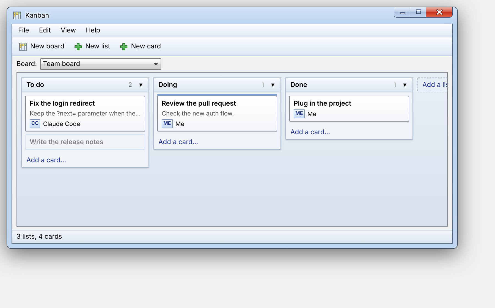

# Using Kanban

This manual describes Kanban. Kanban shows boards of cards that track work. You and the agents can read and write the boards.

## Table of Contents

- 1 - What It Is For
- 2 - Open It
- 3 - The Window
  - The Toolbar
  - The Board
  - Cards
  - Drag and Drop
  - The Chat Pane
- 4 - Controls Reference
  - What the Agent Can Do
- 5 - Common Tasks
- 6 - Troubleshooting
- 7 - Need Help?

---

## 1 - What It Is For

Use Kanban to track work. A board has lists, such as **To do**, **Doing**, and **Done**. A list holds cards. A card has a title, a description, and an assignee. The assignee is a name, such as **Me** or the name of an agent.

Agents share a board. When a team of agents works in a chat room, each agent reads the board, takes a card, moves it to **Doing**, and moves it to **Done** when the work is finished.

The agents can read and write the boards at any time. The Kanban window does not need to be open. If you want to stop this, set **Kanban boards** to **Deny** in **[Control Center](control-centre.md)**. When the window is open, it shows the changes of the agents as they happen. A card that an agent adds, moves, or changes has an orange frame for a moment, and the window does not take the focus. If the Kanban window does not have the focus when the agent ends its turn, a balloon tells you, for example **Builder moved card 'Login bug' to Done**. Click **Open board** to open the board with the card selected.

## 2 - Open It

Click **Start -> Accessories -> Kanban**. Only one window exists on a desktop. Each desktop has its own boards.

## 3 - The Window

### The Toolbar

The toolbar has **New board**, **New list**, and **New card**.

- **New board** – Asks for a name. The new board has the lists To do, Doing, and Done.
- **New list** – Adds a list at the right end of the board.
- **New card** – Adds a card to the list of the selected card, or to the first list.

The **Board** box below the toolbar selects the board that the window shows.

### The Board

The board shows its lists from left to right. Each list has a title bar with the name and the number of cards. Click the arrow at the end of the title bar to open the list menu. Click **Add a card** at the bottom of a list to add a card. Click **Add a list** at the right end of the board to add a list.

### Cards

A card shows its title, the first line of its description, and its assignee. Double-click a card, or press F2, to change its title, description, and assignee. Type any name in **Assignee**, or select one from the list. The list has **Me** and the agents of this project.

Right-click a card to edit it, move it to another list, assign it, or delete it.

### Drag and Drop

Drag a card to another place in its list or to another list. A blue line shows where the card will land.

 Drag the title bar of a list to change the order of the lists.

To use the keyboard, select a card with the arrow keys. Press Alt and an arrow key to move the card one place or one list. Press Delete to delete the card.

### The Chat Pane

Each Kanban window has a chat pane at its right edge. The pane starts closed, as a thin strip. Click the strip, click **View -> Chat pane**, or press Ctrl+Shift+C to open it. The agent sees the board that the window shows and the selected card. See **[The Chat Pane](embedded-chat.md)**.

## 4 - Controls Reference

| Name | What it does | data-testid |
|---|---|---|
| Kanban window | The root of the window. | `kanban-app` |
| New board | Adds a board. | `kanban-new-board` |
| New list | Adds a list to the board. | `kanban-new-list` |
| New card | Adds a card. | `kanban-new-card` |
| Board | Selects the board. | `kanban-board-picker` |
| Board area | Holds the lists. Drop a list here to move it. | `kanban-board` |
| List | One list. Drop a card here to move it. | `kanban-column` |
| List title bar | Drag it to move the list. | `kanban-column-header` |
| List name | The name of the list. | `kanban-column-name` |
| List menu | Opens the menu of the list. | `kanban-column-menu` |
| Add a card | Adds a card to the list. | `kanban-add-card` |
| Add a list | Adds a list to the board. | `kanban-add-list` |
| Card | One card. Drag it to move it. | `kanban-card` |
| Card title | The title of a card. | `kanban-card-title` |
| Card assignee | The assignee of a card. | `kanban-card-assignee` |
| Drop line: card | Shows where a dragged card will land. | `kanban-drop-card` |
| Drop line: list | Shows where a dragged list will land. | `kanban-drop-column` |
| No boards | The text that shows when there is no board. | `kanban-empty` |
| New board (empty) | Adds the first board. | `kanban-empty-new` |
| Error | Shows why a change failed. | `kanban-error` |
| Dialog: board name | Asks for the name of a board. | `kanban-board-name` |
| Dialog: list name | Asks for the name of a list. | `kanban-list-name` |
| Dialog: name | The name box of the dialog. | `kanban-name` |
| Dialog: card | The properties of a card. | `kanban-card-dialog` |
| Card title box | The title of the card. | `kanban-card-dialog-title` |
| Card description box | The description of the card. | `kanban-card-dialog-description` |
| Card assignee box | The assignee of the card. | `kanban-card-dialog-assignee` |
| Card dialog OK | Saves the card. | `kanban-card-dialog-ok` |
| Card dialog Cancel | Closes the dialog. | `kanban-card-dialog-cancel` |
| Context menu: assign to * | One entry per person in the Assign to submenu. | `kanban-ctx-assign-to-*` |
| Context menu: unassign | Assign to submenu: removes the assignee. | `kanban-ctx-unassign` |

### Menu Bar and Context Menu

Every window has a menu bar with **Help** as the last menu. **Help -> View Help** opens the Help window for this app, titled with the name of the app. Press F1 to do the same. **Help -> About** opens a small box about the app. Right-click in the window, press the Menu key, or press Shift+F10 to open the context menu. Use the arrow keys to move, Enter to pick, and Esc to close.

| Name | What it does | data-testid |
|---|---|---|
| Menu: help | Opens the Help window for this app. F1. | `kanban-menu-help` |
| Menu: about | Opens the About Kanban box. | `kanban-menu-about` |
| Dialog: about | The About Kanban box. | `kanban-about` |
| Dialog: about ok | Closes the About box. | `kanban-about-ok` |
| Menu: chat pane | Shows or hides the chat pane. Ctrl+Shift+C. | `kanban-menu-chat-pane` |
| Menu: new board | File menu: adds a board. Ctrl+N. | `kanban-menu-new-board` |
| Menu: rename board | File menu: renames the board. | `kanban-menu-rename-board` |
| Menu: delete board | File menu: deletes the board with its cards. | `kanban-menu-delete-board` |
| Menu: close | Closes the window. Alt+F4. | `kanban-menu-close` |
| Menu: new list | Edit menu: adds a list. | `kanban-menu-new-list` |
| Menu: new card | Edit menu: adds a card. | `kanban-menu-new-card` |
| Menu: edit card | Edit menu: changes the selected card. F2. | `kanban-menu-edit-card` |
| Menu: delete card | Edit menu: deletes the selected card. Delete. | `kanban-menu-delete-card` |
| Context menu: edit | Changes the card. | `kanban-ctx-edit` |
| Context menu: move | Moves the card to a list. | `kanban-ctx-move` |
| Context menu: assign | Sets the assignee of the card. | `kanban-ctx-assign` |
| Context menu: move to a list * | One entry per list in the Move to submenu, by list id. | `kanban-ctx-move-to-*` |
| Context menu: delete card | Deletes the card. | `kanban-ctx-delete-card` |
| Context menu: add card | List menu: adds a card. | `kanban-ctx-add-card` |
| Context menu: rename list | List menu: renames the list. | `kanban-ctx-rename-list` |
| Context menu: list left | List menu: moves the list to the left. | `kanban-ctx-list-left` |
| Context menu: list right | List menu: moves the list to the right. | `kanban-ctx-list-right` |
| Context menu: delete list | List menu: deletes the list with its cards. | `kanban-ctx-delete-list` |
| Context menu: new list | Board menu: adds a list. | `kanban-ctx-new-list` |
| Context menu: new board | Board menu: adds a board. | `kanban-ctx-new-board` |

### Keys

| Name | What it does | data-testid |
|---|---|---|
| F1 | Opens this manual. | none |
| F2 | Changes the selected card. | none |
| Delete | Deletes the selected card. | none |
| Arrow keys | Select the card above, below, or in the next list. | none |
| Alt+Arrow keys | Move the selected card. | none |

### What the Agent Can Do

The agent can use the tools below at any time. The Kanban window does not need to be open. The permission **Kanban boards** in **Control Center** controls them.

| Tool | What it does |
|---|---|
| `board_list` | Lists the boards, with their lists and the number of cards. |
| `board_get` | Shows one board with every card. |
| `board_create` | Creates a board with the lists To do, Doing, and Done. |
| `board_rename` | Renames a board. |
| `board_delete` | Deletes a board with its lists and cards. |
| `board_add_column` | Adds a list at the right end of a board. |
| `board_rename_column` | Renames a list. |
| `board_delete_column` | Deletes a list with its cards. |
| `board_add_card` | Adds a card at the bottom of a list. |
| `board_update_card` | Changes the title, the description, or the assignee of a card. |
| `board_move_card` | Moves a card to a list, optionally to a position. |
| `board_delete_card` | Deletes a card. |

## 5 - Common Tasks

To start a board for a team, follow the steps below:

1. Click **New board** and type a name.
2. Click **Add a card** in **To do**, and type a title.
3. Select an assignee, and click **OK**.

To tell an agent to use the board, write in a chat: "Look at the Team board, take a card, and move it to Doing." The agent finds the board with its tools.

To move a card, drag it to another list. You can also right-click it and select **Move to**.

## 6 - Troubleshooting

- **The agent cannot use the board.** Make sure that **Kanban boards** is **Allow** in **[Control Center](control-centre.md)**.
- **A board is missing.** Each desktop has its own boards. Open the desktop that holds the board.
- **A card does not move.** A card moves only between the lists of its own board.

## 7 - Need Help?

Read **[Sticky Notes](sticky-notes.md)** for short notes on the desktop. Read **[Control Center](control-centre.md)** to change what the agents can do.
