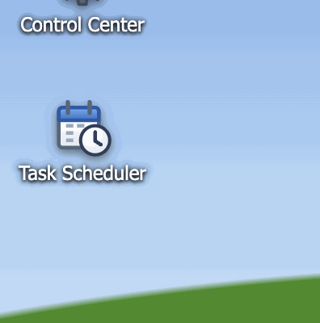
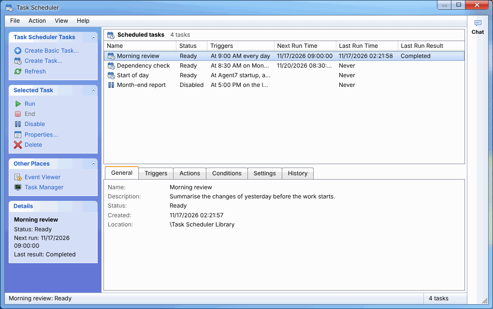
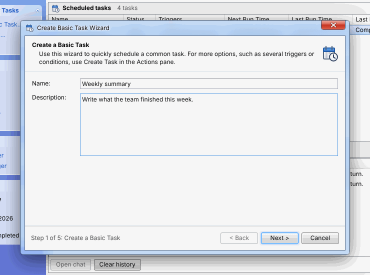
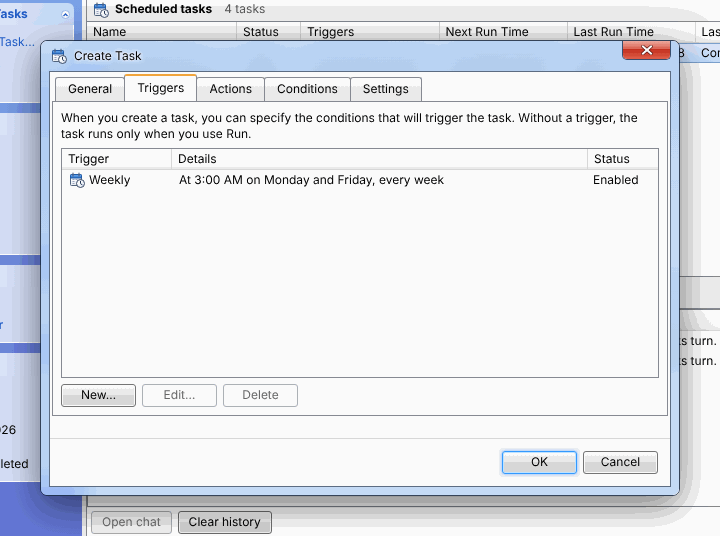
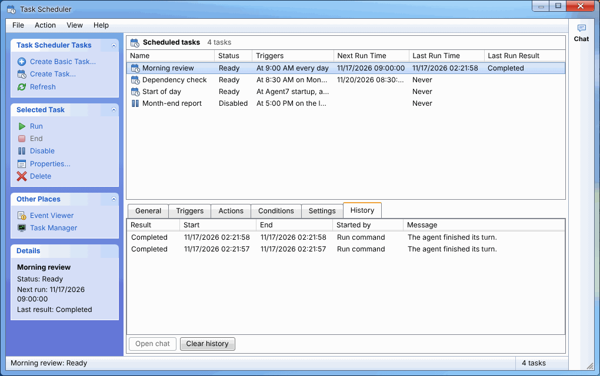

# Using Task Scheduler

This manual describes Task Scheduler. Task Scheduler asks an agent to do a job at a time that you choose. The job can run once, or again and again, for example every morning.

## Table of Contents

- 1 - What It Is For
- 2 - Open It
- 3 - The Window
  - The Task Pane
  - The Task List
  - The Details Pane
  - Create Basic Task
  - Create Task and Properties
  - Triggers
  - Actions
  - Conditions
  - Settings
  - History
  - The Event Viewer Log
- 4 - Controls Reference
- 5 - Common Tasks
- 6 - Troubleshooting
- 7 - Need Help?

---

## 1 - What It Is For

Use Task Scheduler to start work without you. A task has a name, one or more triggers, and one or more actions. A trigger says when the task starts. An action says what the task does. Task Scheduler has one kind of action: **Run an agent**. The action sends a prompt to an agent, in a project that you choose.

Task Scheduler works like the Scheduled Tasks folder of Windows XP, with more choices. A task can have conditions, for example "only if no chat is working". A task also keeps a history of its runs.

Agent7 runs the tasks while it runs. The Task Scheduler window does not need to be open. If Agent7 is closed at the time that a task is due, the task does not start. Look at **Run missed tasks** in chapter 3 for the one exception.

**Note:** A task starts a new chat in the project, or sends the prompt to a chat that you choose. The chat has no window of its own. The agent can use the tools of the apps that are open on the desktop. If the agent asks for permission, the question waits in the Action Center until you answer.

## 2 - Open It

Use one of the ways below to open Task Scheduler:

- Double-click **Task Scheduler** on the desktop.
- Click **Start -> System Tools -> Task Scheduler**.
- Click **Task Scheduler** in the **Other Places** section of a window that has it.

Only one Task Scheduler window opens on a desktop. Each desktop has its own tasks. Agent7 keeps the tasks when you close the window and when you restart Agent7.

## 3 - The Window

The window has a menu bar at the top. Below it, the task pane is on the left. The task list is at the top right, and the details pane is under the list. The status bar at the bottom shows the status of the selected task and the number of tasks.

### The Task Pane

The task pane is the blue strip at the left side of the window. It has four sections. Click the arrow at the end of a section title to fold the section.

- **Task Scheduler Tasks** – Has **Create Basic Task...**, **Create Task...**, and **Refresh**.
- **Selected Task** – Has **Run**, **End**, **Disable** or **Enable**, **Properties...**, and **Delete**. A link is gray when it does not apply to the selected task.
- **Other Places** – Opens **Event Viewer** and **Task Manager**.
- **Details** – Shows the counts of your tasks. When you select a task, it shows the name, the status, the next run, and the last result of the task.

### The Task List

The list has one row for each task. Each row has an icon that shows the status.

- **Name** – The name of the task.
- **Status** – **Ready**, **Running**, or **Disabled**. A task with waiting runs shows how many wait, for example "Running (2 queued)".
- **Triggers** – The triggers in words, for example "At 9:00 AM every day". A trigger that is off has "(off)" after it. A task without a trigger shows "Manual. Use Run."
- **Next Run Time** – The time of the next start. The column is empty for a disabled task and for a task with no start in the future.
- **Last Run Time** – The start of the last run, or "Never".
- **Last Run Result** – **Completed**, **Failed**, **Stopped**, **Not started**, **Missed**, or **Running**.

Double-click a row to open **Properties**. Right-click a row for the same commands as the task pane. Click a column title to sort the list.

### The Details Pane

The details pane shows the selected task in six tabs. You can read the tabs here. To change a task, click **Properties...**.

- **General** – The name, the description, the status, the date of creation, and the location of the task.
- **Triggers** – The triggers of the task.
- **Actions** – The actions of the task.
- **Conditions** – The conditions that must hold for a start.
- **Settings** – The settings of the task.
- **History** – The runs of the task, newest first.

### Create Basic Task

Click **Create Basic Task...** to open the wizard. The wizard asks one question on each page. The title of the page is in the header band. The number of the step is at the lower left. Click **Next >** to go to the next step and **< Back** to go to the previous step.

1. **Create a Basic Task** – Type a name and, if you want, a description.
2. **Task Trigger** – Select when the task starts: **Daily**, **Weekly**, **Monthly**, **One time**, or **At Agent7 startup**.
3. **Trigger Details** – Set the start and how often the task repeats. The fields depend on your choice in step 2.
4. **Action** – Select the agent, the project, the chat, and type the prompt.
5. **Summary** – Read the task. Click **Finish** to save it.

If a step has a problem, a red line at the bottom says what to do. The wizard does not go on until you fix it. Select **Open the Properties dialog for this task when I click Finish** to see all options of the new task. The wizard makes a task with the standard conditions and settings.

### Create Task and Properties

Click **Create Task...** to make a task with all options. Click **Properties...** to change a task. Both open the same dialog box. It has five tabs.

- **General** – The name, the description, and **Enabled**. A task that is not enabled does not start by itself.
- **Triggers** – The list of triggers. Click **New...**, **Edit...**, or **Delete**.
- **Actions** – The list of actions. Click **New...**, **Edit...**, or **Delete**.
- **Conditions** – The conditions of the task.
- **Settings** – The settings of the task.

Click **OK** to save. If something is missing, a red line below the tabs says what it is, and the dialog box stays open.

### Triggers

A task can have any number of triggers. A task without a trigger starts only when you click **Run**. Click **New...** on the **Triggers** tab to add one. Select the kind in **Begin the task**.

- **One time** – Starts once, at the date and time that you set.
- **Daily** – Starts at the time you set, every number of days that you choose. The first start is on the start day.
- **Weekly** – Starts at the time you set, on the days of the week that you select, every number of weeks that you choose. A week starts on Sunday.
- **Monthly** – Starts at the time you set, on the days of the months that you select. Select **Last** to start on the last day of each selected month.
- **At Agent7 startup** – Starts after Agent7 started. Set a delay of 0 to 1440 minutes.

Each trigger that is not a startup trigger also has these fields:

- **Expire** – The trigger does not start after this date and time.
- **Enabled** – Clear this box to turn the trigger off and keep it in the list.

These rules apply to the times of a trigger:

- A month that does not have the day that you selected is skipped. For example, day 31 does not start in April. Select **Last** to start on the last day of each month.
- A time that does not exist is moved to the first time after the gap. When the clocks go forward from 2:00 AM to 3:00 AM, a start at 2:30 AM happens at 3:30 AM.
- A time that happens twice, when the clocks go back, starts at the first of the two times.
- Nothing starts before the start date and time. Nothing starts after the expiration.

**Tip:** The **Next Run Time** column shows the result of these rules. Use it to make sure that a trigger does what you want.

### Actions

The action **Run an agent** has four settings:

- **Agent** – The agent that runs. **Default agent** uses the agent that is the default when the task starts. If the agent that you selected is removed, the default agent runs instead.
- **Project** – The place where the agent works. The list has **Your files (C:)** and the plugged-in projects. If the project is not plugged in when the task starts, the run fails and the history says so.
- **Chat** – **Start a new chat for every run**, or **Send the prompt to this chat**. A new chat has the name of the task and the time. The chat stays in the chat list.
- **Prompt** – The text that the agent receives.

A task with more than one action runs the actions one after the other. If an action fails, the later actions do not run.

### Conditions

A condition must hold when a trigger starts the task. If it does not hold, the run does not start. The history shows **Not started** and says why. **Run** ignores the conditions.

- **Start the task only if the desktop is not paused** – This box is on by default.
- **Start the task only if no chat of this desktop is working or waiting for an answer** – The task waits for a quiet time.
- **Start the task only if no other task of this desktop runs** – Only one task runs at a time.

### Settings

- **Allow the task to be run on demand** – Makes **Run** work for this task.
- **Run the task as soon as possible after a scheduled start is missed** – Applies when Agent7 was closed, or the computer was asleep, at the scheduled time. A start that is less than two minutes late counts as on time. Many missed starts make one run. If this box is off, the history shows **Missed**.
- **If the task fails, restart every** – Starts the task again after the number of minutes that you set. **at most** sets the number of restarts.
- **Stop the task if it runs longer than** – Ends a run after the number of minutes that you set. The history shows **Stopped**.
- **If the task is already running** – Select one rule: **Do not start a new instance**, **Queue a new instance**, or **Stop the existing instance**. At most 10 runs wait in the queue.

### History

The **History** tab lists the runs of the selected task. Agent7 keeps the last 100 runs of each task.

- **Result** – **Running**, **Completed**, **Failed**, **Stopped**, **Not started**, or **Missed**.
- **Start** and **End** – The times of the run.
- **Started by** – **Schedule**, **Agent7 startup**, **Run command**, **Missed schedule**, or **Restart after failure**. A restart shows the number of the attempt.
- **Message** – One sentence that says what happened.

Select a run and click **Open chat** to open the chat that the run used. Click **Clear history** to delete the runs of the task.

### The Event Viewer Log

Task Scheduler writes each start, end, failure, and change of a task to the **Task Scheduler** log in **[Event Viewer](event-viewer.md)**. A failure is an error in the log. The error goes away from the Activity gadget when a later run of the same task completes.

## 4 - Controls Reference

| Name | What it does | data-testid |
|---|---|---|
| Task Scheduler window | The root of the window. | `task-scheduler-app` |
| File -> Create Basic Task... | Opens the wizard. | `task-scheduler-menu-create-basic` |
| File -> Create Task... | Opens the dialog box for a new task. | `task-scheduler-menu-create` |
| File -> Close | Closes the window. | `task-scheduler-menu-close` |
| Action -> Run | Starts the selected task. | `task-scheduler-menu-run` |
| Action -> End | Ends the selected task. | `task-scheduler-menu-end` |
| Action -> Disable or Enable | Turns the selected task off or on. | `task-scheduler-menu-toggle` |
| Action -> Properties... | Opens the properties of the selected task. | `task-scheduler-menu-properties` |
| Action -> Delete | Deletes the selected task. | `task-scheduler-menu-delete` |
| View -> Refresh | Reads the tasks again. F5 does the same. | `task-scheduler-menu-refresh` |
| View -> Chat pane | Shows or hides the chat pane. | `task-scheduler-menu-chat-pane` |
| Help -> View Help | Opens this manual. | `task-scheduler-menu-help` |
| Help -> About Task Scheduler | Opens the About box. | `task-scheduler-menu-about` |
| About box | Names the app and its version. | `task-scheduler-about` |
| About box OK | Closes the About box. | `task-scheduler-about-ok` |
| Task pane | The blue pane at the left side. | `task-scheduler-pane` |
| Task Scheduler Tasks section | Holds the links to make tasks. | `task-scheduler-section-tasks` |
| Selected Task section | Holds the links for the selected task. | `task-scheduler-section-selected` |
| Other Places section | Holds the links to other apps. | `task-scheduler-section-places` |
| Details section | Shows the counts or the selected task. | `task-scheduler-section-details` |
| Task pane links | All links of the task pane end with the name of the command. | `task-scheduler-action-*` |
| Create Basic Task... | Opens the wizard. | `task-scheduler-action-create-basic` |
| Create Task... | Opens the dialog box for a new task. | `task-scheduler-action-create` |
| Refresh | Reads the tasks again. | `task-scheduler-action-refresh` |
| Run | Starts the selected task now. | `task-scheduler-action-run` |
| End | Stops the running task and drops the queued runs. | `task-scheduler-action-end` |
| Disable or Enable | Turns the selected task off or on. | `task-scheduler-action-toggle` |
| Properties... | Opens the properties of the selected task. | `task-scheduler-action-properties` |
| Delete | Deletes the selected task after you answer Yes. | `task-scheduler-action-delete` |
| Event Viewer | Opens Event Viewer. | `task-scheduler-place-event-viewer` |
| Task Manager | Opens Task Manager on the chats. | `task-scheduler-place-task-manager` |
| Details of the task | The name, status, next run, and last result. | `task-scheduler-details` |
| Counts of the tasks | Shown when no task is selected. | `task-scheduler-overview` |
| Ready count | The number of tasks that are ready. | `task-scheduler-overview-ready` |
| Running count | The number of tasks that run. | `task-scheduler-overview-running` |
| Disabled count | The number of tasks that are off. | `task-scheduler-overview-disabled` |
| Failed count | The number of tasks whose last run failed. | `task-scheduler-overview-failed` |
| Next task | The task that starts next. | `task-scheduler-overview-next` |
| Task list | Lists the tasks. | `task-scheduler-list` |
| Task row | One task. | `task-scheduler-row` |
| Number of tasks | The count above the list. | `task-scheduler-count` |
| Task total | The count in the status bar. | `task-scheduler-total` |
| No task selected | The line under the list. | `task-scheduler-none` |
| Details pane | The tabs of the selected task. | `task-scheduler-detail` |
| Detail tabs | All tabs of the details pane end with the name of the tab. | `task-scheduler-tab-*` |
| General tab | Shows the general data. | `task-scheduler-tab-general` |
| Triggers tab | Shows the triggers. | `task-scheduler-tab-triggers` |
| Actions tab | Shows the actions. | `task-scheduler-tab-actions` |
| Conditions tab | Shows the conditions. | `task-scheduler-tab-conditions` |
| Settings tab | Shows the settings. | `task-scheduler-tab-settings` |
| History tab | Shows the runs. | `task-scheduler-tab-history` |
| General page | The general data of the task. | `task-scheduler-general` |
| Task name | The name in the General page. | `task-scheduler-general-name` |
| Triggers list | The triggers of the task. | `task-scheduler-triggers` |
| Actions list | The actions of the task. | `task-scheduler-actions` |
| Conditions list | The conditions of the task. | `task-scheduler-conditions` |
| Settings list | The settings of the task. | `task-scheduler-settings` |
| History list | The runs of the task. | `task-scheduler-history` |
| History row | One run. | `task-scheduler-history-row` |
| Open chat | Opens the chat of the selected run. | `task-scheduler-history-open-chat` |
| Clear history | Deletes the runs of the task. | `task-scheduler-history-clear` |
| Right-click menu: Run | Starts the task. | `task-scheduler-ctx-run` |
| Right-click menu: End | Ends the task. | `task-scheduler-ctx-end` |
| Right-click menu: Disable or Enable | Turns the task off or on. | `task-scheduler-ctx-toggle` |
| Right-click menu: Properties... | Opens the properties. | `task-scheduler-ctx-properties` |
| Right-click menu: Delete | Deletes the task. | `task-scheduler-ctx-delete` |
| Right-click menu: Create Basic Task... | Opens the wizard. | `task-scheduler-ctx-create-basic` |
| Right-click menu: Create Task... | Opens the dialog box for a new task. | `task-scheduler-ctx-create` |
| Right-click menu: Refresh | Reads the tasks again. | `task-scheduler-ctx-refresh` |
| Wizard | The Create Basic Task wizard. | `basic-wizard` |
| Wizard page | The page of the step. | `basic-wizard-body` |
| Wizard header | The title and the text of the step. | `basic-wizard-header` |
| Step number | Shows the step, for example "Step 2 of 5". | `basic-wizard-step-number` |
| Wizard name | The name of the task. | `basic-wizard-name` |
| Wizard description | The description of the task. | `basic-wizard-description` |
| Trigger kind | Selects when the task starts: daily, weekly, monthly, once, or startup. | `basic-wizard-kind-*` |
| Wizard trigger fields | The fields of the trigger. | `basic-wizard-trigger-fields` |
| Wizard start | The start date and time. | `basic-wizard-trigger-start-date`, `basic-wizard-trigger-start-date-open`, `basic-wizard-trigger-start-time` |
| Wizard recur | The number of days or weeks between starts. | `basic-wizard-trigger-every` |
| Wizard delay | The delay after the start of Agent7. | `basic-wizard-trigger-delay` |
| Wizard weekdays | One box for each day, Sunday is 0. | `basic-wizard-trigger-dow-0`, `basic-wizard-trigger-dow-1`, `basic-wizard-trigger-dow-2`, `basic-wizard-trigger-dow-3`, `basic-wizard-trigger-dow-4`, `basic-wizard-trigger-dow-5`, `basic-wizard-trigger-dow-6` |
| Wizard months | One box for each month, January is 1. | `basic-wizard-trigger-month-1` to `basic-wizard-trigger-month-12` |
| Wizard days | One box for each day of the month. | `basic-wizard-trigger-day-1` to `basic-wizard-trigger-day-31` |
| Wizard last day | Starts on the last day of the month. | `basic-wizard-trigger-last-day` |
| Wizard action fields | The fields of the action. | `basic-wizard-action-fields` |
| Wizard agent | Selects the agent. | `basic-wizard-action-agent` |
| Wizard project | Selects the project. | `basic-wizard-action-project` |
| Wizard new chat | Starts a new chat for every run. | `basic-wizard-action-session-new` |
| Wizard existing chat | Sends the prompt to one chat. | `basic-wizard-action-session-existing` |
| Wizard chat | Selects the chat. | `basic-wizard-action-chat` |
| Wizard prompt | The prompt for the agent. | `basic-wizard-action-prompt` |
| Wizard summary | The task before you save it. | `basic-wizard-summary` |
| Open Properties | Opens the properties after Finish. | `basic-wizard-open-properties` |
| Wizard problem | Says what is wrong in the step. | `basic-wizard-problem` |
| < Back | Goes to the previous step. | `basic-wizard-back` |
| Next > | Goes to the next step. | `basic-wizard-next` |
| Finish | Saves the task. | `basic-wizard-finish` |
| Cancel | Closes the wizard. | `basic-wizard-cancel` |
| Task dialog box | The Create Task and Properties dialog box. | `task-editor` |
| Task General tab | Opens the General tab. | `task-editor-tab-general` |
| Task Triggers tab | Opens the Triggers tab. | `task-editor-tab-triggers` |
| Task Actions tab | Opens the Actions tab. | `task-editor-tab-actions` |
| Task Conditions tab | Opens the Conditions tab. | `task-editor-tab-conditions` |
| Task Settings tab | Opens the Settings tab. | `task-editor-tab-settings` |
| Task name field | The name of the task. | `task-editor-name` |
| Task description field | The description of the task. | `task-editor-description` |
| Enabled | Lets the task start by itself. | `task-editor-enabled` |
| Trigger list | The triggers of the task. | `task-editor-triggers` |
| Trigger row | One trigger. | `task-editor-trigger-row` |
| New trigger | Adds a trigger. | `task-editor-trigger-new` |
| Edit trigger | Changes the selected trigger. | `task-editor-trigger-edit` |
| Delete trigger | Removes the selected trigger. | `task-editor-trigger-delete` |
| Action list | The actions of the task. | `task-editor-actions` |
| Action row | One action. | `task-editor-action-row` |
| New action | Adds an action. | `task-editor-action-new` |
| Edit action | Changes the selected action. | `task-editor-action-edit` |
| Delete action | Removes the selected action. | `task-editor-action-delete` |
| Conditions page | The conditions of the task. | `task-editor-conditions` |
| Desktop not paused | Condition: the desktop is not paused. | `task-editor-cond-not-paused` |
| Agents idle | Condition: no chat works or waits. | `task-editor-cond-idle` |
| No other task | Condition: no other task runs. | `task-editor-cond-no-other` |
| Settings page | The settings of the task. | `task-editor-settings` |
| Run on demand | Allows Run. | `task-editor-set-on-demand` |
| Run missed | Runs a missed start as soon as possible. | `task-editor-set-missed` |
| Restart on failure | Starts a failed task again. | `task-editor-set-restart` |
| Restart interval | The minutes between restarts. | `task-editor-set-restart-interval` |
| Restart attempts | The number of restarts. | `task-editor-set-restart-attempts` |
| Stop if longer | Ends a long run. | `task-editor-set-stop` |
| Stop minutes | The minutes before the end of a run. | `task-editor-set-stop-minutes` |
| If already running | The rule for a task that runs. | `task-editor-set-if-running` |
| Task problem | Says why the task is not saved. | `task-editor-problem` |
| Trigger dialog box | The New Trigger and Edit Trigger dialog box. | `trigger-dialog` |
| Begin the task | Selects the kind of trigger. | `trigger-dialog-kind` |
| Trigger fields | The fields of the trigger. | `trigger-dialog-fields` |
| Trigger start | The start date and time. | `trigger-dialog-start-date`, `trigger-dialog-start-date-open`, `trigger-dialog-start-time` |
| Trigger recur | The number of days or weeks between starts. | `trigger-dialog-every` |
| Trigger delay | The delay after the start of Agent7. | `trigger-dialog-delay` |
| Trigger weekdays | One box for each day, Sunday is 0. | `trigger-dialog-dow-0`, `trigger-dialog-dow-1`, `trigger-dialog-dow-2`, `trigger-dialog-dow-3`, `trigger-dialog-dow-4`, `trigger-dialog-dow-5`, `trigger-dialog-dow-6` |
| Trigger months | One box for each month, January is 1. | `trigger-dialog-month-1` to `trigger-dialog-month-12` |
| Trigger days | One box for each day of the month. | `trigger-dialog-day-1` to `trigger-dialog-day-31` |
| Trigger last day | Starts on the last day of the month. | `trigger-dialog-last-day` |
| Expire | Sets the end of the trigger. | `trigger-dialog-expire` |
| Expiration | The date and time of the end. | `trigger-dialog-expires-date`, `trigger-dialog-expires-date-open`, `trigger-dialog-expires-time` |
| Trigger enabled | Turns the trigger on or off. | `trigger-dialog-enabled` |
| Trigger problem | Says why the trigger is not saved. | `trigger-dialog-problem` |
| Action dialog box | The New Action and Edit Action dialog box. | `action-dialog` |
| Action fields | The fields of the action. | `action-dialog-fields` |
| Action agent | Selects the agent. | `action-dialog-agent` |
| Action project | Selects the project. | `action-dialog-project` |
| Action new chat | Starts a new chat for every run. | `action-dialog-session-new` |
| Action existing chat | Sends the prompt to one chat. | `action-dialog-session-existing` |
| Action chat | Selects the chat. | `action-dialog-chat` |
| Action prompt | The prompt for the agent. | `action-dialog-prompt` |
| Action problem | Says why the action is not saved. | `action-dialog-problem` |

## 5 - Common Tasks

### Ask an Agent for a Report Every Morning

To ask an agent for a report each day, follow the steps below:

1. Click **Create Basic Task...** in the task pane. The wizard opens.
2. Type `Morning review` in **Name**. Click **Next >**.
3. Select **Daily**. Click **Next >**.
4. Set the start time to 9:00 AM. Make sure that **Recur every** is 1 day. Click **Next >**.
5. Select the project. Type the prompt, for example `Review the changes of yesterday and write a short summary.`
6. Click **Next >**, then click **Finish**. The task appears in the list with the status **Ready**.

### Start a Task on Two Days of the Week

To start a task every Monday and Friday, follow the steps below:

1. Click **Create Task...** in the task pane. The dialog box opens.
2. Type a name on the **General** tab.
3. Click the **Actions** tab. Select the action, click **Edit...**, type the prompt, and click **OK**.
4. Click the **Triggers** tab and click **New...**.
5. Select **Weekly** in **Begin the task**. Select **Monday** and **Friday** and clear the other days.
6. Click **OK** in the trigger dialog box, then click **OK** in the task dialog box.

### Run a Task Now

To run a task now, select the task and click **Run** in the task pane. The status changes to **Running**. The **History** tab shows the run. To stop the task, click **End**.

### Turn a Task Off

To keep a task and stop its starts, select the task and click **Disable**. The status is **Disabled**. Click **Enable** to turn it on again.

### Find Out Why a Task Failed

To see why a task failed, follow the steps below:

1. Select the task.
2. Click the **History** tab.
3. Read the **Message** of the failed run.
4. Select the run and click **Open chat** to see what the agent did.

### Delete a Task

To delete a task, select it, click **Delete**, and click **Yes**. Agent7 deletes the history of the task. The chats that the task started stay in the chat list.

## 6 - Troubleshooting

| Problem | Fix |
|---|---|
| The task did not start at its time. | Make sure that the task is **Enabled** and that Agent7 was open. Read the **History** tab. A row **Missed** means that Agent7 was closed. A row **Not started** names the condition that did not hold. |
| The history says "Not started" and names the paused desktop. | Click **Resume agents and continue** on the top bar, or clear the condition **Start the task only if the desktop is not paused**. |
| The task shows **Running** for a long time. | The agent waits for an answer. Open the Action Center and answer the question. Click **End** to stop the task. |
| **Run** is gray. | The task is disabled, or **Allow the task to be run on demand** is off in the properties. |
| The run failed because the project is not plugged in. | Plug in the project again, or open **Properties...** and select another project in the action. |
| The run failed with "The chat is busy with another message." | The task sends its prompt to a chat that works on another answer. Wait for the chat to finish, or select **Start a new chat for every run**. |
| The run failed with "The chat of this task no longer exists." | Someone deleted the chat. Open **Properties...**, click the **Actions** tab, and select another chat. |
| The agent cannot use a tool. | The agent uses the tools of the apps that are open on the desktop. Open the app, or change the permissions in **[Control Center](control-centre.md)**. |
| A monthly task did not start in February. | The month does not have the day that you selected. Select **Last** to start on the last day of each month. |
| A task started one hour later than set. | The clocks went forward. A time that does not exist moves to the first time after the gap. |

### What Task Scheduler Does Not Do

- It does not run an action that is not **Run an agent**. It does not start programs or send mail.
- It does not repeat a task inside a day, for example every hour. Use a daily trigger for each time of the day.
- It does not start Agent7. A task starts only while Agent7 runs.
- It does not run one prompt with several agents. Make one task for each agent.
- It does not open a window for the chat of a run. Click **Open chat** in the **History** tab.

## 7 - Need Help?

If this manual does not answer your question, read the next topic that fits:

- **[The Desktop](desktop.md)** – The taskbar, the Start menu, and the Action Center.
- **[Event Viewer](event-viewer.md)** – The Task Scheduler log.
- **[Task Manager](agent-manager.md)** – The chats that tasks start.
- **[Control Center](control-centre.md)** – Agents and permissions.
- **[Keyboard](keyboard.md)** – The keys of Agent7.

To open this manual from the window, press F1.
